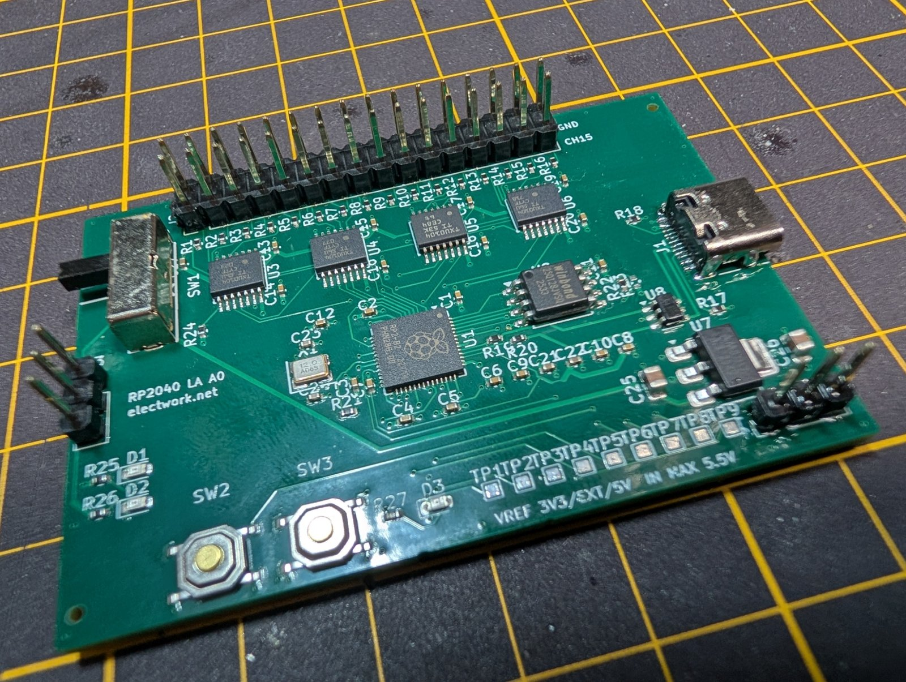

# RP2040 16ch ロジックアナライザ基板

RP2040 と TI の TXU0104（レベル変換 ×4）で作った、**16ch のロジックアナライザ基板**です。1.8V〜5V のロジックをそのまま受け、[sigrok-pico](https://github.com/pico-coder/sigrok-pico) のファームを書くと **PulseView（sigrok）から I2C・SPI・UART をデコード**できます。4 層・65 × 45mm で、部品実装は JLCPCB の PCBA に任せています。



| 項目 | 内容 |
|:---|:---|
| ch 数 | 16ch（GP0〜GP15） |
| 入力 | 1.8V〜5V のロジック（最大 5.5V）。TXU0104 のシュミット入力・内蔵プルダウン |
| しきい値の基準 | VREF をスライドスイッチ SW1 で選ぶ（3.3V／EXT／5V） |
| ファーム | sigrok-pico `pico_dig26.uf2`（PulseView nightly の `raspberrypi-pico` ドライバ） |
| 基板 | 4 層（L1 信号／L2 GND／L3 電源／L4 信号）・65 × 45mm・1.6mm |
| 製造 | JLCPCB（PCB＋Economic PCBA） |

---

## 状態（2026-10-04）

- **A0 基板が到着し、立ち上げ済み。** 3.3V レール（3.303V）・水晶 12MHz・RP2040 内蔵 LDO（1.096V）・入力しきい値を実測し、PulseView で I2C をデコードできるところまで確認しました（詳細は記事の第2回）
- 第3回（実戦投入・サンプリング上限の実測）は準備中です

### 既知の問題：SW1 のコモンはピン 2（A0 の基板配線は誤り）

VREF 切替スイッチ SW1（SK13D07VG5・C393948）のコモンは**ピン 2**（孤立したピン 1 の隣）です。A0 の基板は pad1 をコモン（VREF）として配線しており、誤りです。改修前の A0 では、

- 「5V」位置で LDO の 3.3V 出力と USB の 5V が直結します
- 「EXT」位置で J3 に 3.3V が出ます

**A0 の改修方法（部品側）**: pad2（3.3V）は内層の電源プレーンに直結でパターンを切れないため、スイッチのピン 1 とピン 2 を基板の穴から切り離し、**スイッチのピン 2（コモン）→ pad1（VREF）、スイッチのピン 1 → pad2（3.3V）**をジャンパ線で交差させます。改修後の VREF は「3.3V」3.303V／「EXT」0V（J3 未接続）／「5V」4.895V でした。

- 回路図と自作シンボル（`lib/logicana.kicad_sym`）は訂正済みです（[SPEC.md §17](SPEC.md)）
- **PCB と製造データは A0 のまま**です。次版 A1 で pad1 と pad2 の割り当てを入れ替えます

---

## 製造データ

| 置き場所 | 中身 | 扱い |
|:---|:---|:---|
| **[hardware/jlcpcb/](hardware/jlcpcb/)** | JLCPCB の注文ページからダウンロードした BOM / CPL / Gerber | **実装の正（正規データ）**。配布のファイル名のまま置きます |
| [hardware/out/](hardware/out/) | KiCad（kicad-cli）から出力した Gerber・ドリル・BOM（`bom-jlcpcb.csv`）・CPL（`cpl-jlcpcb.csv`）・DRC・照合表 | 設計側の出力。JLCPCB に上げる前のデータ |

- A0 の発注では、**USB-C（J1）は注文時に部品が入手できなかったため、実装から外して手はんだ**にしました。正規データ（`hardware/jlcpcb/`）はその状態の注文を反映しています
- SW1 とピンヘッダ J2・J3 は THT 部品なので、設計段階から手はんだの予定です
- 上の既知の問題のとおり、A0 の PCB データは SW1 の配線が誤っています。同じデータで発注する場合は、届いた基板を上の方法で改修してください

---

## ファーム

1. sigrok-pico の [release フォルダ](https://github.com/pico-coder/sigrok-pico/tree/main/pico_sdk_sigrok/release)から **`pico_dig26.uf2`** を取得する
2. BOOT ボタン（SW2）を押しながら USB を挿す（またはリセットする）と、PC に RPI-RP2 ドライブが現れる。フラッシュが空なら自動でこの状態になる
3. `pico_dig26.uf2` を RPI-RP2 ドライブにコピーする → COM ポート（VID 2E8A / PID 000A）が現れる

- **`pico_baseline.uf2` は書かないでください。** GP0 を UART の送信ピンとして出力にするため、CH0 の TXU0104 の出力とぶつかります（[SPEC.md §2.3](SPEC.md)）
- PulseView は**リリース版 0.4.2 では使えません**（`raspberrypi-pico` ドライバが未収録）。[sigrok Downloads](https://sigrok.org/wiki/Downloads) から nightly 版を入れ、Connect to Device でドライバ **RaspberryPI PICO (raspberrypi-pico)** と COM ポートを選んでスキャンします
- **PulseView のチャンネル名は D2 から始まります。** 基板の **CH n は PulseView の D(n+2)**（CH0 = D2、CH15 = D17）です（sigrok-pico release の README にある PulseView 側の仕様）

---

## 使い方（最小）

### VREF の選び方

TXU0104 の入力しきい値は、入力側電源 VREF（VCCA）に応じて変わります。**測る相手の電源電圧に VREF を合わせます。**

| 測る相手 | SW1 | 備考 |
|:---|:---|:---|
| 3.3V ロジック | 3.3V | 基板内の LDO 出力 |
| 5V ロジック | 5V | USB の VBUS |
| 1.8V などそれ以外 | EXT | J3 に相手の電源電圧を入れる。**VREF 3.3V のままでは 1.8V ロジックの High を安定して読めません** |

- **J3（外部 VREF）を外してから SW1 を切り替えてください。** SW1 は shorting 型で、切り替えの途中で外部電源と内蔵電源が一瞬つながります
- EXT 位置で J3 に何もつないでいないと、**全 ch が反応しません**（VREF = 0V で TXU0104 の出力が Hi-Z）。VREF の LED（D2）が消えていれば、この状態です

### プローブヘッダ J2

2×16 ピン（2.54mm）。**内側 1 列が CH0〜CH15、外側 1 列はすべて GND** です。1ch ごとに隣の GND を使えます。

### 注意

- プローブ入力と EXT は **0〜5.5V** まで。過電圧・負電圧の保護回路はありません（直列 100Ω のみ）
- しきい値付近の信号は、入力の雑音がヒステリシスを超えるとトグルします。配線を短くし、GND をしっかり取ってください

---

## ディレクトリ構成

```
README.md            この文書
SPEC.md              仕様書（ファーム選定・IC 選定・入力回路・ピン割り当て・BOM・実機チェックリスト・改版メモ）
KICAD-KIT.md         KiCad の作業メモ（ライブラリ・BOM/CPL の出し方・4 層の DRC とスタックアップ・回路図チェックリスト）
docs/images/         README 用の写真
hardware/            KiCad 10 プロジェクト
  rp2040-logic-analyzer.kicad_pro / .kicad_sch / .kicad_pcb
  sym-lib-table / fp-lib-table      logicana / lcsc の登録（${KIPRJMOD}/../lib/...）
  out/                              kicad-cli の出力（schematic.pdf・Gerber・BOM / CPL・DRC・照合表・review/）
  jlcpcb/                           JLCPCB からダウンロードした正規の製造データ
tools/
  gen_schematic.py   回路図の生成スクリプト（Python 3.12・標準ライブラリのみ）
  verify_netlist.py  kicad-cli のネットリストを期待表と照合
  check_kit5.py      回路図チェックリストをネットリストから機械検査
lib/
  logicana.kicad_sym 自作シンボル 4 個（TXU0104PWR / SW_SP3T_SK13D07VG5 / SW_Push_TS1187A / VREF）
  lcsc/              LCSC 由来のライブラリ（リポジトリに含めない・下記で各自生成）
```

回路図は [hardware/out/schematic.pdf](hardware/out/schematic.pdf)（A3・1 ページ）で見られます。

---

## 回路図の再現手順

回路図は手描きではなく `tools/gen_schematic.py` の出力です。部品の位置・結線・ネット名はすべてスクリプトに書いてあり、再実行すると同じファイルになります（UUID は固定名前空間の uuid5）。前提は `uv`（cpython 3.12）と KiCad 10（`kicad-cli`）。

```
uv run tools/gen_schematic.py                # hardware/ に .kicad_sch / .kicad_pro / sym-lib-table / fp-lib-table を出力
uv run tools/gen_schematic.py --check        # 既存出力と一致するか（冪等性の確認）
uv run tools/gen_schematic.py --selftest     # 回転ごとのピン位置を kicad-cli のネットリストで実測
kicad-cli sch erc --severity-all --format report -o hardware/out/erc.rpt hardware/rp2040-logic-analyzer.kicad_sch
uv run tools/verify_netlist.py               # → hardware/out/netlist-check.md
uv run tools/check_kit5.py                   # → hardware/out/kit5-check.md
kicad-cli sch export pdf -o hardware/out/schematic.pdf hardware/rp2040-logic-analyzer.kicad_sch
```

KiCad 標準ライブラリと `lib/logicana.kicad_sym` からシンボルを読み、`extends` を平坦化して `lib_symbols` に埋め込みます。結線はピン端のスタブ＋ローカルラベル、電源レールは電源シンボルです。ネットが変わる変更はスクリプト側に入れて再生成します。

### LCSC 由来のライブラリ（clone した人がやること）

`lib/lcsc/` はリポジトリに含めていません（LCSC / EasyEDA 由来で、再配布できるライセンスか確認できなかったため）。次のコマンドで各自の環境に生成し、KiCad 10 の形式に上げます。

```
py -m pip install --user easyeda2kicad
py -m easyeda2kicad --full --project-relative --lcsc_id C318884 --output <repo>/lib/lcsc/lcsc --overwrite
py -m easyeda2kicad --full --project-relative --lcsc_id C393948 --output <repo>/lib/lcsc/lcsc --overwrite
py -m easyeda2kicad --full --project-relative --lcsc_id C2286   --output <repo>/lib/lcsc/lcsc --overwrite
py -m easyeda2kicad --full --project-relative --lcsc_id C165948 --output <repo>/lib/lcsc/lcsc --overwrite
kicad-cli fp  upgrade <repo>/lib/lcsc/lcsc.pretty
kicad-cli sym upgrade <repo>/lib/lcsc/lcsc.kicad_sym
```

| LCSC | 部品 | 用途 |
|:---|:---|:---|
| C318884 | タクトスイッチ | SW2 / SW3 のフットプリント（必須） |
| C393948 | スライドスイッチ SK13D07VG5 | SW1 のフットプリント（必須） |
| C2286 | LED 赤 0603 | 照合用（任意・標準の `LED_SMD:LED_0603_1608Metric` を使う） |
| C165948 | USB-C 16P | 照合用（任意・標準の `Connector_USB:USB_C_Receptacle_HRO_TYPE-C-31-M-12` を使う） |

---

## 記事（electwork.net）

- 第1回 設計と発注: https://electwork.net/posts/jlcpcb-rp2040-logic-analyzer-01-design-and-order/
- 第2回 立ち上げ: https://electwork.net/posts/jlcpcb-rp2040-logic-analyzer-02-bringup-first-i2c-decode/
- 第3回 実戦投入（予定）

---

## 提供

この基板の製造と部品実装は、JLCPCB の提供を受けています（PR）。JLCPCB: https://jlcpcb.com/jp?from=RamTuckeyPCB

---

## ライセンス

**この基板の設計データのライセンスは未定です。LICENSE ファイルを追加するまでは All rights reserved とします。**

| 対象 | ライセンス・扱い |
|:---|:---|
| ファーム（sigrok-pico） | GPL-3.0。別のプロジェクトで、このリポジトリには含めていません |
| LCSC / EasyEDA 由来のライブラリ（`lib/lcsc/` など） | 同梱しません（`.gitignore` で除外。上の手順で各自生成） |
| KiCad 標準ライブラリ | 同梱しません |
| [gusmanb/logicanalyzer](https://github.com/gusmanb/logicanalyzer)（GPL-3.0） | 回路図・レイアウトは流用していません。TXU0104 採用という部品選定の事実のみ参考にしました |

---

## English summary

A 16-channel logic analyzer board based on the Raspberry Pi RP2040 and four TI TXU0104 level translators. It accepts 1.8 V to 5 V logic (max 5.5 V) with a selectable reference voltage (VREF: 3.3 V / external / 5 V via slide switch SW1), and works with PulseView (sigrok) through the [sigrok-pico](https://github.com/pico-coder/sigrok-pico) firmware `pico_dig26.uf2` (requires a PulseView nightly build; channel CH n appears as D(n+2) in PulseView). 4-layer, 65 x 45 mm, assembled by JLCPCB PCBA.

- **Status (2026-10-04):** Rev A0 boards are up and running (3.3 V rail, 12 MHz crystal and input thresholds measured; I2C decoded in PulseView).
- **Known issue:** The common pin of SW1 (SK13D07VG5) is pin 2, not pin 1. The A0 PCB routes it incorrectly; A0 boards need a jumper rework on the switch side (switch pin 2 → pad1/VREF, switch pin 1 → pad2/3.3V). The schematic and symbol are corrected; the PCB will be fixed in Rev A1.
- **Manufacturing data:** The authoritative BOM/CPL/Gerber are the files downloaded from JLCPCB, stored as-is in `hardware/jlcpcb/`. `hardware/out/` contains the KiCad outputs. In the A0 order, the USB-C connector (J1) was excluded from assembly because the part was unavailable, and was hand-soldered.
- Do not flash `pico_baseline.uf2` (it drives GP0 as UART TX and conflicts with CH0).
- The boards were provided by JLCPCB (sponsored).
- **License:** Not yet decided. All rights reserved until a LICENSE file is added.
- Articles (Japanese): [Part 1](https://electwork.net/posts/jlcpcb-rp2040-logic-analyzer-01-design-and-order/), [Part 2](https://electwork.net/posts/jlcpcb-rp2040-logic-analyzer-02-bringup-first-i2c-decode/)
