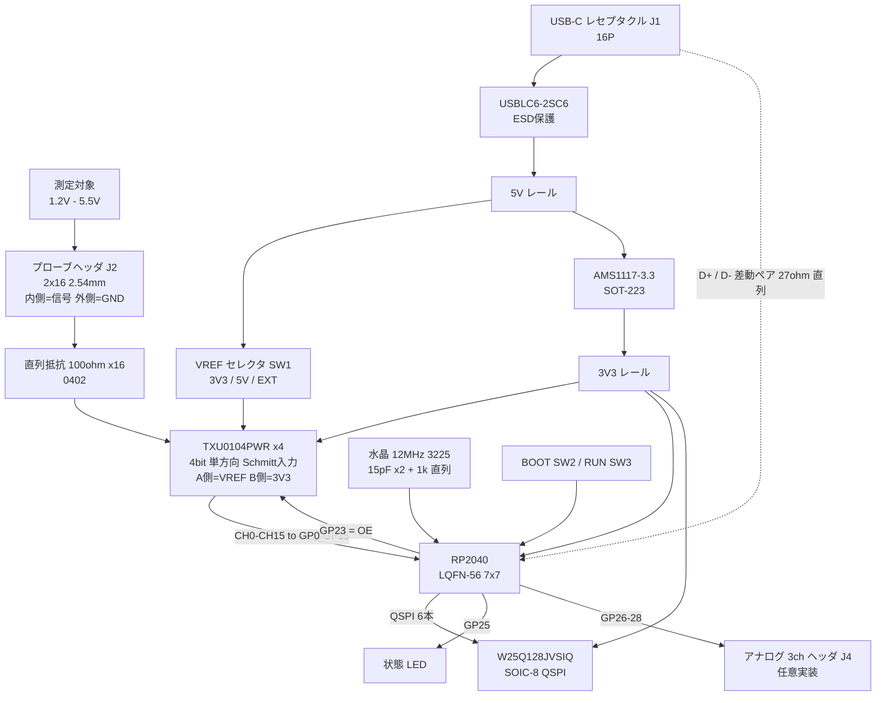

# RP2040 ロジックアナライザ基板 SPEC — JLCPCB コラボ第1弾

PulseView（sigrok）で使える 16ch ロジックアナライザ基板の設計仕様。
**回路図・レイアウトは人間が KiCad で描く。** ここは「何を載せて、どう繋いで、なぜそう決めたか」の定義書。

- 対象: JLCPCB PCBA（実装サービス）で組む前提。読者が同じデータを発注して追体験できることが価値
- 調査日: 2026-09-09（価格・在庫・リポジトリの更新日はすべてこの日時点）
- 裏取り: GitHub の README / ソース、TI・Raspberry Pi のデータシート、JLCPCB 公式ページのみ。確認できなかったものは「未確認」と明記した
- **2026-09-20 改訂**: 回路図レビュー（`hardware/out/review/REVIEW.md`）の 4 指摘を一次で検証して反映（§2.1・§2.2・§2.3・§4.4・§5.3・§5.4・§6・§6.1・§7・§9.3・§10・§11・§14）。**回路図・PCB・BOM は無変更**。回答は `hardware/out/review/RESPONSE.md`
- **2026-10-04 改訂**: SW1 のコモンを**実物のテスター実測でピン 2 に訂正**（§5.4・§6・§10・§11 #7・§17）。回路図は自作シンボルのピン番号を修正。**PCB・BOM・CPL は無変更**（A0 基板は部品側で改修・PCB は次版 A1 で直す）。経緯は §17 改版メモ

---

## 1. 何をする基板か

RP2040 の PIO でデジタル入力を高速に取り込み、USB CDC で PC に流し、**PulseView 上で I2C / SPI / UART をデコードする**。

| 観点 | 内容 |
|:---|:---|
| 作る理由 | 手持ち機材にロジックアナライザが無い。オシロはあるので波形は撮れるが、**プロトコルのデコード画面が撮れない**。これが以後の技術記事の弱点になっている |
| 読者が得るもの | ①「PIO で 100MS/s を取る」という RP2040 の一番おいしい使い方の実例 ②Gerber と BOM をそのまま JLCPCB に投げれば自分の手元に実物が来る ③以後の I2C/SPI 記事に本物のデコード画面が載る |
| JLCPCB から見た絵 | 4 層基板 + **Economic PCBA**。0.4mm ピッチ QFN-56（RP2040）・0402 チップ・TSSOP-14 を実装する、「個人では手はんだしづらいが PCBA なら一発」という題材。実装済み基板が届いて即動く、という筋書きが撮れる |

**手はんだでは作りにくい、という点が企画の芯。** RP2040 は LQFN-56（7×7mm、**裏面中央にサーマル / GND パッド**）で、中央パッドはコテでは届かない。ホットプレートでもステンシルが要る。PCBA を使う必然性が説明できる題材になっている。

---

## 2. ファームウェア基盤の選定 ★最重要

**基板のピン割り当てはファームウェアに従う。** 先にここを決めないと GPIO が決まらない。

### 2.1 候補の比較

| | **sigrok-pico**（pico-coder） | **LogicAnalyzer**（gusmanb） | **μLA**（dotcypress） | **logic_analyzer_rp2040**（dgatf） |
|:---|:---|:---|:---|:---|
| PulseView 対応 | **ネイティブ**。libsigrok の `raspberrypi-pico` ドライバ | **無し**。自前 GUI。CSV を PulseView に import は可 | `ols` ドライバ（SUMP/OLS 互換） | `ols` ドライバ（拡張 SUMP） |
| リリース版 PulseView で動くか | **動かない**。README に「PulseView 0.4.2 and sigrok-cli 0.7.2 do not support sigrok-pico」。nightly が必要 | — | **動く**。README のログに libsigrok 0.5.2 と出ている | 動くが libsigrok に既知バグ（最大レート／サイズの表示が誤り）。作者の fork で修正 |
| ch 数 | 21（baseline）／**26**（dig26）／32（dig32・RP2040 では GPIO 不足） | 24 | 16 | 16 |
| 最大サンプルレート | 120 Msps（PIO 上限）。ただし **8ch 以上では 60 Msps 以下を推奨**（DMA の read-modify-write のため） | 100 Msps（TURBO で 200、blast で 400 Msps） | 100 Msps（1 sample / sys tick） | 200 MHz（README 記載値） |
| 取り込み深度 | RP2040 で DMA バッファ 220,000 B。15〜21ch なら **5万サンプル以下**で 120Msps、それを超えると 167 ksps + RLE | 128 KiB（Pico 2 は 384 KiB） | 200 KB | 10万サンプル／プリトリガ 1K |
| トリガ | **ソフトウェアトリガのみ**（Rev2 で HW トリガを削除）。level / rising / falling / changing、プリキャプチャ比 0〜100% | **HW トリガが強い**。エッジ／fast pattern（5ch・200Msps）／complex pattern（16bit・66Msps）＋**外部トリガ出力**（ダイオード経由、遅延 20ns / 35ns） | PIO による fast trigger | level / edge、1 ステージに 4 トリガまで、RLE |
| アナログ | **3ch**（GP26〜28、7bit、合計 500 ksps）※baseline のみ。**配布バイナリの baseline はこの基板に書けない（§2.3）ので、使うなら `UART_EN 0` の自前ビルド** | 無し | 無し | 無し |
| ライセンス | GPL-3.0 | GPL-3.0 | **Apache-2.0 / MIT デュアル** | GPL-3.0 |
| 最終 push | **2026-08-07** | 2026-08-23 | 2025-02-10 | 2026-03-29 |
| star | 1,095 | 4,959 | 941 | 19 |
| 想定ピン | baseline: GP2〜22（D2〜D22）＋ GP26〜28（ADC）／dig26: **GP0〜22 と GP26〜28**／GP23・24・25 は使わない（25 は LED） | `INPUT_PIN_BASE 2` = GP2 起点で 24ch。`COMPLEX_TRIGGER_OUT/IN = GP0 / GP1`（この 2 本を短絡する）。LED は GP25 | **GP0〜15** | **GP0〜15**。GP16 = デバッグ UART、GP18 / GP19 = 起動時コンフィグ |
| 言語 | C（Pico SDK） | C（Pico SDK）＋ C# / AvaloniaUI アプリ | **Rust** | C（Pico SDK） |

一次 URL:

- sigrok-pico — https://github.com/pico-coder/sigrok-pico （README / USER_GUIDE.md / TECHNICAL.md / `pico_sdk_sigrok/sr_device.h` / `pico_sdk_sigrok/release/README.md`）
- gusmanb/logicanalyzer — https://github.com/gusmanb/logicanalyzer （README / `Firmware/LogicAnalyzer_V2/LogicAnalyzer_Board_Settings.h` / Release v6.0.0.1）
- dotcypress/ula — https://github.com/dotcypress/ula
- dgatf/logic_analyzer_rp2040 — https://github.com/dgatf/logic_analyzer_rp2040
- libsigrok にドライバが在ることの確認 — https://github.com/sigrokproject/libsigrok/tree/master/src/hardware に `raspberrypi-pico` ディレクトリが存在（全 87 ドライバ中）。**リリースタグは `libsigrok-0.5.2` が最新**で、sigrok-pico のマージは 2023 年 9 月なので**どのリリースにも入っていない**
- sigrok 配布 — https://sigrok.org/wiki/Downloads 最新リリースは PulseView 0.4.2 / sigrok-cli 0.7.2 / libsigrok 0.5.2。Windows 向けに `pulseview-NIGHTLY-x86_64-release-installer.exe` の nightly インストーラが公開されている

### 2.2 推奨 — **sigrok-pico を主、μLA を保険**

**主ターゲットは sigrok-pico。** 理由:

1. **唯一「PulseView 用のドライバ」を持っている。** 他の 2 つ（μLA / dgatf）は SUMP という汎用プロトコルに乗っているだけで、デバイス固有の設定（アナログ ch、RLE モード、ch 数）は PulseView から触れない。sigrok-pico は `raspberrypi-pico` という自分のドライバがあるので、PulseView の Device Configuration が本来の姿で出る
2. **一番動いている。** 2026-08-07 push。2025 年に DMA を書き直し、RP2350 対応と 26 / 32ch モードを追加している。基板の第 2 版で RP2350 に載せ替える道が開いている
3. **アナログ 3ch がおまけで付く。** 7bit・500ksps と粗いが、PulseView で**デジタルとアナログを同じ画面に並べられる**のは記事の絵になる。**ただし配布バイナリの `pico_baseline.uf2` はこの基板に書き込めない**（GP0 を UART TX 出力にして CH0 と衝突する・§2.3）。アナログを使うなら `UART_EN 0` で自前ビルドする。標準は `pico_dig26.uf2`（デジタル 16ch のみ）

弱点が 2 つある。設計で埋められるものと、埋められないものがある。

- **弱点 A: リリース版 PulseView では動かない。** 読者に「nightly を入れてください」と言うことになる → 記事②で nightly の入れ方を丁寧に書く。それでも心配なので、**基板を μLA / dgatf でもそのまま動くピン配置にする**（§2.3）
- **弱点 B: ソフトウェアトリガのみ。** ホスト側でトリガ判定するためストリーミング速度が PC 性能に引きずられる。深い取り込みでは gusmanb に劣る → **これは基板では直せない。記事で正直に書く**

**gusmanb は採らない。** ハードウェアとしては一番よくできている（24ch・400Msps blast・複合トリガ・外部トリガ出力）が、**PulseView にライブで繋がらない**。自前 GUI に sigrok のプロトコルデコーダを取り込む方式で、PulseView から見ると CSV のインポート元でしかない。今回の要件（PulseView で使える）を満たさない。

> ただし gusmanb は**部品選定の実証データとして極めて有用**。V6.0 の JLCPCB 用 BOM（Release v6.0.0.1 の `BOM_JLCPCB.zip`）に **TXU0104PWR（LCSC C2938871）が 6 個**入っており、100Msps 動作の実績がある。フロントエンドの選定はこれを踏まえる（§5）。

### 2.3 ピン割り当ての設計方針 — 4 つのファームが同居できる並びにする

4 候補のピン要求を重ねると、**GP0〜GP15 を CH0〜CH15 に素直に並べる**と大半が成立する。

| ファーム | GP0〜15 の扱い | 追加で要求するピン | この基板で動くか |
|:---|:---|:---|:---|
| sigrok-pico `pico_dig26.uf2` | D0〜D15 として取り込む（**PulseView 上の表示は D2 から始まる**仕様） | GP16〜22・GP26〜28 も入力扱いになる。GP25 = LED | **○ そのまま — 標準ファーム** |
| sigrok-pico `pico_baseline.uf2` | **GP0 を UART0 TX として出力駆動する**（`UART_EN 1`）。GP0 には U3 の B1Y 出力が直結なので**出力同士が衝突** | GP26〜28 = アナログ 3ch | **✗ 使用禁止（GP0 が UART TX 出力になり CH0 と衝突）** |
| μLA | GP0〜15 = ch0〜15 | 無し | **○ そのまま** |
| dgatf SUMP | GP0〜15 = ch0〜15 | GP16 = デバッグ UART、GP18 / GP19 = 起動時コンフィグ（GND 短絡で選択） | **○ そのまま**（GP18/19 未接続なら内蔵プルダウンで既定動作） |
| gusmanb | 既定は `INPUT_PIN_BASE 2`。**GP0 / GP1 をトリガ用に潰す**ので衝突する | — | **× 要ヘッダ改変**（`INPUT_PIN_BASE 0` ＋ トリガピンを GP20 / 21 へ。`BUILD_ZERO` プロファイルが `INPUT_PIN_BASE 0` の前例） |

つまり **16ch / GP0〜GP15 なら 3 つのファームが無改造で動く**（sigrok-pico dig26・μLA・dgatf）。1 枚の基板で 3 通りの PulseView 接続を試せるのは、記事としても保険としても効く。

> **標準ファームは `pico_dig26.uf2`。`pico_baseline.uf2` はこの基板に書き込まない**（2026-09-20 確定・回路図レビュー #1）。
>
> - 根拠: `pico_sdk_sigrok/sr_device.h` は baseline（`PICO_MODE 0`）を `GPIO_D_MASK 0x7FFFFC`（GP2〜22）・**`UART_EN 1`** と定義し、`pico_sdk_sigrok.c` の `main()` が `#if (UART_EN == 1)` で `uart_init(uart0, 115200)`・`gpio_set_function(0, GPIO_FUNC_UART)`・`gpio_set_function(1, GPIO_FUNC_UART)` を実行する。GP0 は「ch にならない」のではなく **UART TX として出力駆動される**
> - この基板では GP0 に TXU0104（U3）の B1Y 出力が直結。OE は R24 で常時有効なので、プローブを外した状態でも TXU 側は Low（A 入力の内蔵プルダウン）を出し、UART のアイドル High と**電流を取り合う**。R1 の 100Ω は J2 と A 入力の間にあり、この経路には入っていない。「14ch ＋ アナログ」の互換構成にはならない
> - dig26（`PICO_MODE 1`）は `UART_EN 0`・`GPIO_D_MASK 0x1C7FFFFF`（GP0〜22 ＋ GP26〜28）で GP0〜15 を入力にする。問題なし
> - **アナログ 3ch（J4）が要る場合**は `PICO_MODE 0` に `UART_EN 0` を当てた**自前ビルドのみ可**。配布バイナリの baseline は使わない
> - **`PIN_TEST_MODE` も禁止。** 測定ピンを出力にして起動テストするビルドで、ソース自身が「can cause drive fights if any drivers are connected」と警告している。この基板は常に TXU0104 が繋がっている
> - 採用する UF2 は版を固定する: main ブランチの `pico_sdk_sigrok/release/pico_dig26.uf2`（2026-09-20 取得・SHA-256 `3a10298a00f21d74bd963b95baa381e238212a863fd4645908a676c21647f953`・100,352 バイト）。同日の `pico_baseline.uf2` のフラッシュイメージには `Uart Char %d` などの UART 文字列が入っており、`UART_EN 1` でビルドされていることがバイナリ側でも確認できる
> - 一次: https://github.com/pico-coder/sigrok-pico/blob/main/pico_sdk_sigrok/sr_device.h ／ https://github.com/pico-coder/sigrok-pico/blob/main/pico_sdk_sigrok/pico_sdk_sigrok.c ／ https://github.com/pico-coder/sigrok-pico/blob/main/pico_sdk_sigrok/release/README.md（いずれも main・2026-09-20 取得）

**「24ch」はどのファームの区切りとも一致しない。** sigrok-pico を選ぶなら 26ch（GP0〜22 ＋ GP26〜28）、それ以外なら 16ch。24 という数字は gusmanb 固有で、その gusmanb は PulseView に繋がらない（§14）。

---

## 3. ブロック図



**電源の流れ**: USB-C 5V → ESD → ① LDO で 3.3V（RP2040 と TXU0104 の B 側）② VREF セレクタ経由で TXU0104 の A 側。RP2040 のコア 1.1V は**チップ内蔵 LDO** が作る（VREG_VOUT を DVDD に配線するだけ）。

---

## 4. IC 選定

### 4.1 MCU — RP2040 で確定（指示）

| 項目 | 値 | 出典 |
|:---|:---|:---|
| LCSC | **C2040**（Raspberry Pi RP2040、LQFN-56 7×7mm） | JLCPCB 部品ライブラリ |
| JLCPCB 区分 | **Extended**（`componentLibraryType: expand`）／在庫 54,362 | 同上（2026-09-09 時点） |
| 単価 | 1+ $0.9893 ／ 10+ $0.9014 ／ 100+ $0.7583 | 同上 |
| GPIO | 30 本（GP0〜GP29）。**全 GPIO が Digital IO (FT)** | RP2040 Datasheet §5.5.2 |
| 入力しきい値 | IOVDD = 3.3V で **VIH 2.0V 以上 / VIL 0.8V 以下**、Schmitt 有効時のヒステリシス 0.2V | RP2040 Datasheet Table 625 |
| **絶対最大定格** | **VPIN は IOVDD + 0.5V まで**（3.3V 運用で 3.8V）。IOVDD は 3.63V まで | RP2040 Datasheet Table 622 |
| 電源ピン | IOVDD ×6（1, 10, 22, 33, 42, 49）／ DVDD ×2（23, 50）／ VREG_VIN 44 ／ VREG_VOUT 45 ／ USB_VDD 48 ／ ADC_AVDD 43 ／ **GND は中央パッド（57）** | RP2040 Datasheet Table 621 |

> **RUN(26) に外付け部品は要らない（2026-09-09 確定）。** RP2040 データシート Table 619 が RUN の Reset State を **Pull-Up** と書いており、ピン説明も「If no external reset is required, this pin can be tied directly to IOVDD」。**公式の Minimal design example（`RPI-RP2040-MINIMAL_R3-S1.kicad_sch`）でも RUN にはプルアップもコンデンサも付いておらず、ヘッダへ引き出しているだけ**。この基板では **SW3 で GND に落とすだけでよい**。

> **「Fault Tolerant」は 5V トレラントの意味ではない。** データシートの定義は「**IOVDD が 0V のとき**に、ピンが 3.63V 以下なら流れ込む電流がごく僅か」。通電中の 5V 入力は絶対最大定格違反になる。フロントエンドで受けるのはこのため。

### 4.2 フラッシュ — W25Q128JVSIQ（**JLCPCB Basic**）

| 候補 | LCSC | 区分 | 100+ 単価 | 在庫 | 判断 |
|:---|:---|:---|--:|--:|:---|
| **W25Q128JVSIQ** ✅ | **C97521** | **base（Basic）** | $1.8012 | 93,727 | **推奨。** 公式の Minimal design example が採用している型番そのもの。16MB は **RP2040 がサポートする最大容量**。Basic なので Economic PCBA の feeder 費 $3.07 が掛からない |
| W25Q32JVSSIQ | C179173 | expand | $1.0576 | 15,053 | 4MB。単価は安いが Extended。**5 枚なら Basic の 128 の方が総額で有利**（差額 $0.74 × 5 = $3.7 < $3.07 ＋ 手間） |
| W25Q16JVSNIQ | C2456211 | expand | $0.7566 | 13,859 | 2MB。同上 |

出典: Raspberry Pi「Hardware design with RP2040」Release 2（build 2026-08-20）§2.2 —「The device chosen here is an W25Q128JVS device …128 Mbit chip (16 MB). This is the largest memory size that RP2040 can support.」

**QSPI_SS まわりの規定**（同 §2.2）:

- QSPI_SS に **10kΩ プルアップ（R2）**。W25Q128 では実測上不要だったため公式は **DNF** 扱い。**別のフラッシュに替えるなら実装が要る**ので、フットプリントは必ず置く
- QSPI_SS と USB_BOOT ヘッダの間に **1kΩ（R1）**。ブート時に QSPI_SS を安全に GND へ引き下げるため。この抵抗が無いと RP2040 がブート時にプルダウンを押し負けできない
- 両方**フラッシュの直近**に置く。QSPI 6 本は短く、直結

### 4.3 水晶 — 12MHz / 3225

| 候補 | LCSC | 区分 | 100+ | 在庫 | 判断 |
|:---|:---|:---|--:|--:|:---|
| X322512MSB4SI（YXC） | **C9002** | **base（Basic）** | $0.0760 | 161,581 | JLCPCB Basic。3225。**ただし ESR / CL が公式指定と同じか要確認** |
| **ABM8-272-T3（Abracon）** ✅ | C20625731 | expand | $0.4052 | 26,535 | **公式推奨品**。Pico と同じ。**初版はこちらを推す** |

Raspberry Pi 公式の指定（Hardware design with RP2040 §2.3 / Table 1）:

| パラメータ | 値 |
|:---|:---|
| 周波数 | 12.000 MHz、基本波 AT カット |
| 周波数許容差 | ±30 ppm |
| **等価直列抵抗 ESR** | **最大 50Ω** |
| **負荷容量 CL** | **10 pF** |
| シャント容量 C0 | 3.0 pF |
| ドライブレベル | 10〜200 µW |
| 外付け負荷容量 | **15pF ×2**（直列で 7.5pF ＋ 基板とピンの寄生 3pF ≒ 10.5pF） |
| **直列ダンピング抵抗** | **1kΩ**（**XOUT 側** — 下記で確定）。IOVDD 3.3V 前提でチューニングされている |

**ダンピング抵抗の位置は XOUT 側で確定（2026-09-09）。** Raspberry Pi 公式の Minimal design example の KiCad 回路図（`RPI-RP2040-MINIMAL_R3-S1.kicad_sch`、[Minimal Viable Board (KiCad)](https://pip.raspberrypi.com/documents/RP-008296-DS)）を直接読んで確認した。R5（1k）は座標 (83.82, 227.33)、`XOUT` ラベルは (97.79, 227.33)、`XIN` ラベルは (97.79, 212.09)。配線は次のとおり。

```
水晶 (68.58, 227.33) ──> R5 左ピン (81.28) … R5 右ピン (86.36) ──> XOUT ラベル (97.79, 227.33)
水晶 (68.58, 212.09) ─────────────────────────────────────────> XIN  ラベル (97.79, 212.09)   ← 抵抗なし
```

**XOUT（発振器の出力）と水晶の間に 1kΩ が入り、XIN 側は直結。** ドライブレベルを絞るのが目的なので、これが定石とも一致する。公式文書の本文は「ESR 最大 50Ω の水晶と 1kΩ 直列抵抗（R5）の組み合わせ」としか書いておらず、どちら側かは**回路図でしか分からない**。

> **要確認（人間）**: C9002（X322512MSB4SI）の **ESR と CL をデータシートで確認**すること。CL が 10pF でなければ 15pF を計算し直す。ESR が 50Ω を大きく超えるなら 1kΩ の直列抵抗を下げる必要がある。公式は「Any changes to crystal parameters risk instability across any components connected to the crystal circuit」と明記している。
>
> **判断が付かなければ ABM8-272-T3（C20625731）を選ぶ。** 差額は 5 枚で $1.6 程度。**発振が立たない基板ほど記事にしづらい失敗は無い。**

### 4.4 電源 — AMS1117-3.3（**JLCPCB Basic**）

| 候補 | LCSC | 区分 | 100+ | 判断 |
|:---|:---|:---|--:|:---|
| **AMS1117-3.3** ✅ | **C6186** | **base（Basic）** | $0.1721 | **推奨。** SOT-223、1A。入出力に 10µF（C25 / C26 = C15850）。**出力側の安定条件はデータシートに「22µF タンタル」しか無い（下記の既知リスク）** |
| RT9013-33GB | C47773 | expand | $0.1139 | SOT-23-5、500mA、低ドロップ。Extended |

公式の Minimal design example は NCP1117（1A・固定 3.3V、入出力 10µF）。AMS1117 はピン互換の定番で JLCPCB Basic なので置き換える。**ただし「入出力に 10µF」は NCP1117 の例であって、AMS1117 のデータシートの規定ではない**（2026-09-20 明記）。

**出力コンデンサ C26 の既知リスク（2026-09-20・回路図レビュー #2）**

- 一次: AMS の `ds1117.pdf`（http://www.advanced-monolithic.com/pdf/ds1117.pdf ・2026-09-20 取得）。LCSC C6186 に付くデータシート（https://datasheet.lcsc.com/datasheet/pdf/e6935943fc6b1bbf350a1a0f3e90dc4a.pdf?productCode=C6186 ）と SHA-256 が一致し（`189a2651…a3f0`・95,151 バイト・8 ページ）同一ファイル
- その Stability 節が書いているのは 3 つだけ。①「出力コンデンサはデバイスの周波数補償の一部として必要」②「**出力に 22µF 固体タンタルを付ければ全動作条件で安定**」③「ADJ 端子をバイパスしないなら（固定電圧版はこれに当たる）より小さい容量でも同等に使える」。**セラミック 10µF（C15850・X5R・低 ESR）での安定性は規定なし。禁止もなし。ESR の下限も無い。** Ripple Rejection など特性表の条件も全て「C_OUT = 22µF Tantalum」
- **判断（人間・2026-09-20）: 初回 5 枚は C25 / C26 = 10µF X5R（C15850）のまま発注する。回路・BOM は変えない。** 代わりに §11 フェーズ 2 の **#5a** で 3V3 レールをオシロで観測し、発振・リンギングの有無を実測で確定する（「設計保証が無い」を「実測で問題なし」に置き換える）
- **発振が見えた場合の手直し候補**（実機で判断・記事にはそのまま書く）
  1. C26 の 0805 パッドに **22µF タンタル（3528 = B ケース）を手はんだ**で載せ替える。データシートどおりの条件になる
  2. C26 と**直列に 0.5〜1Ω** を入れて ESR を持たせる（専用パッドは無いので、C26 の片側パッドとランドの間を切って抵抗を渡す）
- **次リビジョンの検討事項**: セラミック出力コンデンサでの安定を明記した LDO へ変更する。例: **AP2112K-3.3**（SOT-23-5・LCSC **C51118**・Extended・在庫 54,414・$0.1358@100・2026-09-20 JLCPCB 部品 API）。600mA で足りる（下の消費見積り）が **SOT-223 とピン非互換**なのでフットプリント変更を伴う。RT9013-33GB（上表）も同じ理由で候補に残る

消費電流の見積り: RP2040（125MHz 動作・USB 有効）で数十 mA、TXU0104 は 4 個合計で µA オーダー（ICCA + ICCB は 1 個あたり最大 6µA）。**LDO の余裕は十分**。5V → 3.3V のドロップ 1.7V で 100mA なら 0.17W。SOT-223 で問題ない。

### 4.5 USB とコネクタ

| 用途 | 部品 | LCSC | 区分 | 100+ | 備考 |
|:---|:---|:---|:---|--:|:---|
| USB-C レセプタクル | TYPE-C-31-M-12 | C165948 | expand | $0.1468 | 16P。在庫 281,996。定番 |
| ESD | USBLC6-2SC6（ST 純正） | C7519 | expand | $0.1426 | D+ / D− / VBUS をまとめて保護 |
| ESD（廉価代替） | USBLC6-2SC6（UMW） | C2687116 | expand | $0.0383 | 在庫 70,131。セカンドソース |

USB 配線の規定（Hardware design with RP2040 §2.4.1）:

- USB_DP / USB_DM に **27Ω の直列終端**、**チップの直近**に置く
- プルアップ / プルダウンは RP2040 内蔵なので不要
- 差動 90Ω を狙う。公式の Minimal design example は **2 層 1mm 厚で 0.8mm 幅**で実装している
- **CC1 / CC2 に 5.1kΩ を各 1 本**（これが無いと USB-C から 5V が来ない）

---

## 5. 入力フロントエンド ★2 番目に重要

### 5.1 方式比較

| | (a) 直列抵抗 + クランプ | **(b) レベル変換 IC** ✅ | (c) 高インピーダンスバッファ |
|:---|:---|:---|:---|
| 構成 | 100Ω〜1kΩ 直列 ＋ ショットキーで 3V3 / GND にクランプ。RP2040 に直結 | TXU0104 / SN74LVC8T245 を挟む。A 側の基準電圧 VREF を対象に合わせる | 1MΩ‖10pF の分圧 ＋ コンパレータ。市販ロジアナのプローブ相当 |
| **1.8V 入力** | **× 読めない。** RP2040 の VIH は 3.3V 動作で **2.0V**。1.8V ロジックの High（≒1.8V）が届かない | **○** VREF を 1.8V にすればしきい値も 1.8V 基準に下がる | ○ |
| 5V 入力 | △ 直列抵抗で内部クランプダイオードに逃がす。絶対最大定格ぎりぎりの運用 | **○** A 側は VI 0〜5.5V が定格内 | ○ |
| 入力インピーダンス | DC は高い（漏れ 1µA）。**帯域が直列抵抗で決まる。** 1kΩ ×（ピン容量＋ケーブル 30pF）≒ 30ns → 実効 5MHz 程度。100Ω なら 3ns → 50MHz 級 | **Cio 3pF typ / 4pF max、漏れ 1.5µA typ。** 直列 100Ω を足しても時定数 0.4ns。**市販ロジアナ級の軽さ** | 最も軽いが桁違いに高価 |
| 部品点数（16ch） | 抵抗 16 ＋ ダイオード 32 = **48** | **IC 4 ＋ 直列抵抗 16 ＋ パスコン 8 = 28** | コンパレータ 16 個＋周辺で 100 超 |
| JLCPCB 在庫性 | クランプ用ショットキーは Extended が多い | TXU0104 = C2938871 **Extended・在庫 17,079**。gusmanb V6 の量産実績あり | 論外 |
| コスト（16ch 分） | 最安 | TXU0104 ×4 = $1.88（10+ 単価） | 数十ドル |

**推奨は (b)。** 決め手は **「RP2040 の VIH が 2.0V なので、(a) では 1.8V ロジックが物理的に読めない」**という一点。要件の「1.8〜5V 対応」は (a) では満たせない。

### 5.2 レベル変換 IC の選定 — **TXU0104PWR を推奨**

| | **TXU0104PWR** ✅ | SN74LVC8T245PWR |
|:---|:---|:---|
| LCSC / 区分 | **C2938871** / expand / 在庫 17,079 | **C27643** / expand / 在庫 9,855 |
| 100+ 単価 | $0.4703 | **$0.2409** |
| 16ch に必要な数 | 4 個（TSSOP-14） | **2 個**（TSSOP-24） |
| 16ch 分の IC 代 | $1.88 | **$0.48** |
| 電源範囲（両側） | **1.08V 〜 5.5V** | 1.65V 〜 5.5V |
| 方向 | **固定方向（A→B）。** ロジアナ用途にちょうど | 双方向。DIR ピンを固定して使う |
| **入力の性質** | **Schmitt トリガ入力** | **Schmitt なし。** 入力遷移速度に上限（3.3V で **10 ns/V**、5V で 5 ns/V） |
| **未接続入力** | **内蔵プルダウンあり**（Inputs with integrated static pull-down resistors prevent channels from floating） | **要外付け。** データシートが「All unused or driven (floating) data inputs must be held at logic HIGH or LOW」と明記 → **プルダウン 16 本が増える** |
| 最大データレート | Down 5V→3.3V **125 Mbps** ／ Up 1.8V→3.3V **100 Mbps** ／ Up 1.2V→3.3V **30 Mbps** | 未規定。tpd A→B は 3.3V→3.3V で 0.8〜6.3ns |
| 出力スキュー tsk | 5V→3.3V **3ns** ／ 1.8V→3.3V **8ns** ／ 1.2V→3.3V 42ns | 未規定 |
| 入力容量 | Cio **3pF typ / 4pF max** | 未取得（**未確認**） |
| 実績 | **gusmanb V6.0 が 6 個搭載し 100Msps で出荷**（Release v6.0.0.1 の BOM_JLCPCB.csv に C2938871 ×6） | — |

出典: TI SCES937B（TXU0104 / TXUN0104、2025-02 改訂）§1・§5.3・§5.5・§5.6 ／ TI SCES584D（SN74LVC8T245、2026-05 改訂）§5.3・§5.9。

**TXU0104 を推す理由は「測定器だから」。**

1. **Schmitt トリガ入力。** ロジアナは 20cm のジャンパ線でなまった波形を掴む道具。LVC8T245 は「3.3V で 10 ns/V より遅い遷移を入れるな」とデータシートが言っており、汚い波形で発振・多重エッジを起こしうる。**測定器が嘘をつくのが一番まずい**
2. **内蔵プルダウン。** プローブが刺さっていない ch が 0 で安定する。LVC8T245 だとフローティング → 消費電流増と不定表示。外付けプルダウン 16 本を足すと部品点数の差が縮む（28 → LVC 側は IC 2 ＋ R 16 ＋ プルダウン 16 ＋ パスコン 4 = 38）
3. **1.08V 下限。** 要件は 1.8V までだが、1.2V / 1.5V のロジックも一応見える（30 Mbps 止まりだが「見えない」よりましで、記事の実験ネタにもなる）

**「最大 200Mbps」の読み方に注意。** データシートの TMAX 表で 200 Mbps なのは **3.3V → 5.0V の up translation**。この基板の向き（対象 → 3.3V）では **5V 入力で 125 Mbps、1.8V 入力で 100 Mbps** が上限。100 MS/s サンプリングで見える信号は最大 50MHz（= 100 Mbps 相当）なので**ちょうど釣り合っている**が、余裕は無い。**3.3V → 3.3V（同電位）の行はデータシートに無い（未確認）**。

**LVC8T245 を選ぶなら**: 16ch で IC 代が $1.4 安く、実装面積も小さい。「安く作る」を最優先する廉価版（v2）ならあり。**ただし外付けプルダウン 16 本を必ず入れること。**

### 5.3 フロントエンドの構成（1ch あたり）

```
プローブヘッダ ―― 100Ω(0402) ―― TXU0104 Ax
```

- **直列 100Ω**: 事故時の電流制限と反射の抑制。TXU0104 の Cio 4pF に対して時定数 0.4ns なので**帯域を削らない**。1kΩ にすると 4ns になり 100MS/s で効いてくるので、**1kΩ にはしない**
- **クランプは付けない方針。** TXU0104 の A 側は VI 0〜5.5V が定格内で、**VCC が落ちているときも Ioff で高インピーダンス**になる（「If either VCC input is <100 mV or disconnected, all outputs are disabled and become high-impedance」）。5.5V を超える入力の保護は無いので、**シルクと記事で「5.5V まで」を明示する**。gusmanb も同じ割り切りで「BEWARE!!! There is no overvoltage protection」と書いている
- **OE は GP23 で制御 ＋ 10kΩ プルアップ。** GP23 は sigrok-pico の baseline / dig26 のどちらのマスクにも入っていない（`GPIO_D_MASK` = 0x7FFFFC / 0x1C7FFFFF）ので **ch を潰さずに使える**。プルアップを付けておけば OE を触らないファーム（μLA / dgatf）でも常時イネーブルで動く。sigrok-pico（baseline / dig26）は起動時に **GP23 を SIO 出力にして High を出す**（`pico_sdk_sigrok.c` main()・Pico 基板の電源モード切替ピンの流用。`gpio_put_masked(1 << 23, 1 << 23)`）ので、OE は High = 有効で一致する（2026-09-20 ソース確認）

### 5.4 VREF（A 側電源）の与え方

TXU0104 の A 側しきい値は VCCA に追従する（VCCA 3V で VT+ = 1.48〜1.92V、5.5V で 2.65〜3.33V）。したがって **VCCA = 測定対象の電源電圧に合わせる**のが正しい使い方。

| 方式 | 内容 | 判断 |
|:---|:---|:---|
| **3 択スライドスイッチ** ✅ | 3.3V（基板内）／ 5V（USB VBUS）／ EXT（ヘッダから供給） | **推奨。** gusmanb V6 と同じ考え方（同社 BOM に 3 極スライドスイッチ C393948）。一番使う 3.3V と 5V がスイッチ一発で選べるのが実用上大きい |
| ジャンパ ＋ 外部端子のみ | 部品が減る | 3.3V 測定のたびに配線が要る |
| 対象から自動で取る | プローブヘッダの 1 ピンを VREF 入力に | 対象の電源を吸ってしまう危険。EXT として明示的に選ばせる方が安全 |

- **SW1 は shorting（make-before-break）型。接点の並び順を「3.3V ― EXT ― 5V」にすること（2026-09-09 確定）。** SK13D07VG5 のデータシート（首韩科技・図面 2021-06-09 版）は図に **`SCHEMATIC (SHORTING)`** と明記している。**切り替えの途中で隣り合う 2 接点が短絡する**ので、両端に +3V3 と +5V を置くと**スライドするたびに LDO 出力と USB VBUS が直結**し、3.3V レールが RP2040 の絶対最大定格 3.63V を超えて持ち上がる。**間に EXT を挟めば、この 2 つは決して隣り合わない**（EXT は未接続が既定なので、途中で橋渡しされても無害）。**部品代 0 円の対策なので必ず守る**。ただし **EXT に外部電源を繋いだまま切り替えると、途中で外部電源と内蔵電源（3.3V または 5V）が一時的に直結する**。これは並び順では防げないので、**運用制約「J3 を外してから SW1 を切り替える」**（§6.1・2026-09-20 回路図レビュー #3）で回避する
- **SW1 のコモンはピン 2（2026-10-04 実物で訂正・§17）。** 当初はピン 1 をコモンとして設計したが、実物は孤立したピン 1 の**隣のピン 2** がコモン。正しい割り当ては下図のとおりで、スライダ順「3.3V ― EXT ― 5V」の設計意図はそのまま成り立つ

```text
  SW1（SK13D07VG5）の物理の並びとネット（2026-10-04 実物で訂正）

    pad:     1        2        3        4
    x[mm]:   -4       0        +2       +4
    net:     +3V3     VREF     EXT(J3)  +5V
    role:    throw    COM      throw    throw

    slider "3.3V" : COM(2)-1  -> VREF = +3V3
        (moving)  : COM(2)-1 and -3 at once -> +3V3--EXT bridged (EXT open by default)
    slider "EXT"  : COM(2)-3  -> VREF = EXT
        (moving)  : COM(2)-3 and -4 at once -> EXT--+5V bridged
    slider "5V"   : COM(2)-4  -> VREF = +5V

    => +3V3 (pad1) and +5V (pad4) never touch COM at the same time
```

- **EXT 入力には過電圧保護が無い**（5.5V 上限）。シルクに書く
- VCCA には 100nF を各 IC の直近に 1 個（C13 / C15 / C17 / C19）、**VREF レールのバルクとして 1µF を 1 個（C27・C21/C22 と同部品・SW1 コモンの直近・§10 #27）**。1µF 程度なら SW1（shorting 型）の切り替え時の突入は問題にならない（2026-09-20 確定）
- **VREF が 0V のときは全 ch が Hi-Z。**「スイッチを入れ忘れると何も映らない」が正常動作なので、**VREF レールに LED を 1 個**付けるとデバッグが早い

---

## 6. コネクタ・スイッチ・LED

| 参照 | 部品 | 内容 |
|:---|:---|:---|
| J1 | USB-C レセプタクル 16P（C165948） | 給電・通信・ファーム書き込み |
| **J2** | **ピンヘッダ 2×16 2.54mm** | **プローブヘッダ。内側 1 列が CH0〜CH15、外側 1 列は全部 GND** |
| J3 | ピンヘッダ 1×3 | VREF EXT 入力（＋ GND ×2） |
| J4 | ピンヘッダ 1×3（任意・DNF） | アナログ 3ch（GP26 / 27 / 28）。**標準ファーム（dig26）では使えない**（GP26〜28 はデジタル D23〜25 になる）。配布 baseline は使用禁止なので、使うには `UART_EN 0` の自前 baseline ビルドが要る（§2.3） |
| **TP1〜TP7** | テストパッド（銅パッド 1.0mm 角・部品なし） | GP16〜GP22（dgatf のデバッグ UART / コンフィグ用）。KiCad の `Connector:TestPoint` は 1 点 1 シンボルなので、旧「J5」を TP1〜TP7 に改めた（2026-09-20） |
| **TP8, TP9** | テストパッド（同上） | **SWCLK（U1 pin24）／ SWDIO（U1 pin25）**。ファームのデバッグ用（KICAD-KIT §5-15 で「出す」に決着・2026-09-20） |
| SW1 | 3 接点スライドスイッチ（C393948・**THT / ライトアングル**） | VREF 選択。**接点の並びは 3.3V ― EXT ― 5V**（shorting 型のため・§5.4）。**ピン 2 = コモン**（孤立したピン 1 の隣・2026-10-04 実物で訂正・§17）、ピン 1 = 3.3V / 3 = EXT / 4 = 5V |
| SW2 | タクトスイッチ（C318884・**Basic**） | BOOT（QSPI_SS を 1kΩ 経由で GND） |
| SW3 | タクトスイッチ（C318884・**Basic**） | RUN（RESET） |
| D1 | LED 0603（C2286・**Basic**） | 3.3V 通電表示 |
| D2 | LED 0603（C2286・**Basic**） | VREF 通電表示 |
| D3 | LED 0603（C2286・**Basic**） | GP25 ステータス（4 つのファームがいずれも点滅させる） |

> TP8 / TP9 と C27 は 2026-09-20 の決定。回路図第 1 版（commit de18d95）は TP1〜TP7 のみ・C27 なし（SWCLK / SWDIO は no_connect）で、再生成で反映する（KICAD-KIT §5-15 で確認）。

**GND を外側 1 列に全部並べる**のは公式の作法。「It is good practice to include many grounds on I/O connectors. This helps to maintain a low impedance ground, and also to provide plenty of potential return paths for currents travelling to and from the I/O connections.」（Hardware design with RP2040 §2.4.2）。100MS/s のリターン電流を素直に帰すため、**1ch につき GND 1 本**は譲らない。gusmanb V6 も 2×16 ヘッダ（C97095）を使っており、同じ結論に着いている。

**外部トリガ / クロック端子は載せない。** 推奨ファーム（sigrok-pico）にハードウェアトリガが無く、μLA / dgatf にも外部トリガ入出力の口が無いため、**端子を出しても使うファームが無い**。gusmanb を採る設計なら必須になるが、今回は採らない（§14）。

**プローブケーブル**: 2.54mm のジャンパワイヤ（メス−メス）と、フック型 IC クリップの組み合わせで足りる。ロジアナ用として売られている 8ch フラットケーブル＋フックの組も 2×16 ヘッダに刺さるが、**GND 配置が製品ごとに違う**ので現物合わせになる。**具体的な商品は人間が確認（Amazon / 秋月）。未確認。**

### 6.1 使い方 — 運用上の制約（★壊さないために。2026-09-20 回路図レビューで格上げ）

| # | 制約 | 理由 | 手順 |
|--:|:---|:---|:---|
| 1 | **外部 VREF（J3）を接続したまま SW1 を切り替えない** | SW1 は shorting 型（KICAD-KIT §1.2.3）。3.3V ― EXT ― 5V の並びで LDO 出力と VBUS の直結は避けているが、**EXT を経由する切替では、途中で外部電源と内蔵電源（3.3V または 5V）が一時的に直結する**。EXT を真ん中に置くだけでは外部電源への逆流は防げない | **① J3 の EXT ケーブルを外す → ② SW1 で位置を選ぶ → ③ 接続する。** 通電中の切替を許容したければ次リビジョンで non-shorting 型か逆流防止（ダイオード / 理想ダイオード）を検討 |
| 2 | **ファームは `pico_dig26.uf2` を書く。`pico_baseline.uf2`・`PIN_TEST_MODE` ビルドは書かない** | baseline は GP0 を UART TX 出力にして CH0（U3 B1Y）と衝突する（§2.3） | RPI-RP2 ドライブに `pico_dig26.uf2` をドロップ（§11 #11）。版は §2.3 の SHA-256 で固定 |
| 3 | **J4（アナログ 3ch）は標準ファームでは使えない** | dig26 では GP26〜28 がデジタル D23〜25 になる。アナログは `UART_EN 0` の自前 baseline ビルドのみ（§2.3） | 初版は DNF のまま（§14-11） |
| 4 | **EXT 入力は 5.5V まで**（過電圧保護なし） | TXU0104 の VCCA 上限（§5.4） | シルクに明記 |
| 5 | **プローブ入力は 0〜5.5V。過電圧・負電圧・商用電源に対する保護は無い** | 直列 100Ω のみ。クランプ無し（§5.3） | 5.5V 超・負電圧の対象には繋がない |
| 6 | 1.8V ロジックを読むときは **VREF も 1.8V にする**（EXT） | TXU0104 の A 側しきい値は VCCA 追従（§5.4）。VREF は TXU の A 側電源かつ D2 の電源で、高インピーダンスの検出端子ではない | 手順 1 のとおり SW1 = EXT にしてから J3 に 1.8V を接続（TXU の A 側は µA オーダー、D2 の LED 電流が乗る） |

---

## 7. RP2040 ピン割り当て

**ファームウェアに従う。sigrok-pico dig26 / μLA / dgatf のすべてで成立する並び。**

| GPIO | この基板での用途 | sigrok-pico baseline（**使用禁止・§2.3**） | sigrok-pico dig26（**標準**） | μLA | dgatf | gusmanb |
|:---|:---|:---|:---|:---|:---|:---|
| GP0 | **CH0** | **UART TX 出力 → CH0（U3 B1Y）と衝突** | D0 | ch0 | ch0 | 既定はトリガ OUT・要改変 |
| GP1 | **CH1** | UART RX（ch にならない） | D1 | ch1 | ch1 | 既定はトリガ IN・要改変 |
| GP2〜GP15 | **CH2〜CH15** | D2〜D15 | D2〜D15 | ch2〜15 | ch2〜15 | ch0〜13 |
| GP16 | テストパッド TP1 | D16 | D16 | — | **デバッグ UART TX**（115200bps・GP18 = GND で有効） | — |
| GP17 | テストパッド TP2 | D17 | D17 | — | — | — |
| GP18 | テストパッド TP3 | D18 | D18 | — | **起動時コンフィグ: GND でデバッグ有効** | — |
| GP19 | テストパッド TP4 | D19 | D19 | — | **起動時コンフィグ: GND でステージ型（レベル）トリガ** | — |
| GP20〜GP22 | テストパッド TP5〜TP7 | D20〜D22 | D20〜D22 | — | — | gusmanb 改変時のトリガ用に空ける |
| **GP23** | **TXU0104 の OE**（10kΩ プルアップ） | 対象外 | 対象外 | 対象外 | 対象外 | 対象外 |
| GP24 | 未使用 | 対象外 | 対象外 | — | — | — |
| **GP25** | **ステータス LED** | LED | LED | LED | LED | LED |
| GP26〜GP28 | **アナログ 3ch**（J4・任意） | **A0〜A2（ADC）** | D23〜D25 | — | — | — |
| GP29 | 未使用 | — | — | — | — | — |
| QSPI ×6 | W25Q128 へ直結 | | | | | |
| USB_DP / DM | J1 へ（27Ω 直列） | | | | | |
| SWCLK / SWDIO | **TP8 / TP9**（テストパッド・§6） | | | | | |

出典: `pico_sdk_sigrok/sr_device.h`（`GPIO_D_MASK`: baseline = 0x7FFFFC = GP2〜22 ／ dig26 = 0x1C7FFFFF = GP0〜22 ＋ GP26〜28。GP23 / 24 / 25 は両方とも対象外）、μLA readme（「Input channels mapped to GPIO 0-15」）、dgatf README（「The 16 logic analyzer channels are available on GPIOs 0 to 15」「GPIOs 18 and 19 are used for boot-time configuration」、Configuration 節「**GPIO 19 to GND: use stage-based triggers**（PulseView triggers are interpreted as level triggers）」「**GPIO 18 to GND: enable debug mode. Debug output is available on GPIO 16 at 115200 bps**」「If neither GPIO is grounded … Trigger edge override: enabled ／ Debug mode: disabled」。`src/common.h` の `GPIO_DEBUG_ENABLE = 18` / `GPIO_TRIGGER_STAGES = 19` とも一致。https://github.com/dgatf/logic_analyzer_rp2040#configuration ・master・2026-09-20 取得。**旧記載は 18 / 19 が逆だった — 2026-09-20 回路図レビュー #4 で修正**）、`LogicAnalyzer_Board_Settings.h`（`INPUT_PIN_BASE 2`, `COMPLEX_TRIGGER_OUT_PIN 0`, `COMPLEX_TRIGGER_IN_PIN 1`）。

> **注意 1**: sigrok-pico の dig26 では **GP16〜GP22 と GP26〜28 も入力として設定される**。未接続だと不定になるが、RP2040 の GPIO はリセット時プルダウン（Table 615「Reset State: Pull-Down」）なので実害は小さい。気になるなら 10kΩ プルダウンのフットプリント（DNF）を置く。
>
> **注意 2**: dgatf は GP18 / GP19 を起動時コンフィグとして読む。`src/main.c` は両ピンに **`gpio_pull_up()` を掛けてから `gpio_get()`** し、Low のときだけ有効にする（`if (!gpio_get(GPIO_TRIGGER_STAGES)) config_.trigger_edge = false;` ／ `if (!gpio_get(GPIO_DEBUG_ENABLE)) config_.debug = true;`）。したがって**未接続 = High = 既定動作（デバッグ無効・エッジトリガ）**で、内蔵プルダウンで GND と誤認される心配は無い（2026-09-20 ソース確認・旧記載の「未確認」を解消）。デバッグ出力やレベルトリガが欲しいときは、起動時に **TP3（GP18）／ TP4（GP19）を GND へ落とす**。

---

## 8. レイアウト制約

### 8.1 2 層 vs 4 層 — **4 層を推奨**

| 論点 | 2 層 | 4 層 |
|:---|:---|:---|
| USB FS（12Mbps・差動 90Ω） | **足りる。** 公式の Minimal design example は 2 層 1mm 厚・0.8mm 幅で 90Ω を出している | 楽になる（1.6mm 4 層で外層と内層の間隔 0.36mm、0.3mm 幅で 75Ω という実例が公式にある） |
| QSPI 6 本 | 短く直結すれば可 | 同左 |
| **16ch の入力線** | **ここが問題。** 立ち上がりの速い信号 16 本を、GND ベタを削りながら引き回すことになる。リターン経路が切れるとクロストークとリンギングが出る | **べた GND 層が信号層の真下に連続する。** 全 ch のリターンが最短で帰る |
| RP2040 のデカップリング | 公式が「48/49 番ピンでコンデンサを 1 個共用するのは妥協」と明言している | 電源層＋GND 層が平行平板コンデンサとして効く |
| 0.4mm ピッチ QFN-56 のファンアウト | 可能（公式が 2 層でやっている） | 楽 |
| コスト | JLCPCB の公称は **2 層 5 枚 $2.00 から**（100×100mm まで） | 4 層の基板単価は **$70.6 / m²**（2024-03-06 の値下げ告知）。60×50mm × 5 枚 = 0.015 m² なので**面積課金は $1 程度**で、実際は最低料金とエンジニアリング費が支配的 |

公式ドキュメントの記述がそのまま論拠になる（Hardware design with RP2040 §3）:

> 「whereas the minimal design example has two layers, with a 1 mm thick PCB, we've opted for a four-layer, 1.6mm thick PCB. This is primarily because adding extra layers to our PCB means that we can now devote entire layers to power and ground. … we now have a variety of low-impedance paths back to RP2040 where the quickly changing I/O return currents can flow back fast and unhindered, without creating current loops which can cause electromagnetic emissions.」

**16 本の高速入力を測定器として扱う以上、4 層が正解。** PCBA の段取り費（$8.18 ＋ feeder $3.07 × 4）に比べて層数の差額は小さい。**ただし正確な差額は cart.jlcpcb.com/quote で外形を入れないと出ない（未確定）。**

**スタックアップ**: L1 = 信号（部品面）／ L2 = **GND ベタ（切らない）**／ L3 = 3.3V ＋ VREF ／ L4 = 信号・GND ベタ。

### 8.2 レイアウト制約リスト（人間へそのまま渡す文面）

```text
この基板のレイアウト制約:

1. 4 層。L2 は GND ベタで、入力信号の下では絶対に切らない。
2. RP2040 の中央 GND パッドは、複数のビアで L2 の GND ベタに落とす。
3. デカップリングコンデンサは対応する電源ピンの直近に置く。IOVDD は 6 ピンあるので
   原則 1 ピン 1 個（100nF）。VREG_VIN と VREG_VOUT には 1uF を各 1 個、ピンの直近に。
4. QSPI 6 本（フラッシュ）は最短で直結する。他の信号を間に通さない。
   QSPI_SS の 1k(BOOT) と 10k(プルアップ・DNF) はフラッシュの直近。
5. 水晶は XIN/XOUT ピンの直近。負荷容量 15pF x2 と直列 1k も同じ場所にまとめる。
   XIN/XOUT の配線は最短。寄生容量 3pF を前提に計算しているので伸ばさない。
   水晶の直下と周囲には他の信号を通さず、GND で囲う。
6. USB の D+ / D- は差動ペアで、短く、長さを揃える。差動 90 オームを狙う。
   27 オームの直列抵抗は RP2040 の直近に置く。
7. CH0-CH15 の 16 本は、
   (a) プローブヘッダ -> 100 オーム -> TXU0104 の A ピン を最短でまとめる
   (b) TXU0104 の B ピン -> RP2040 の GP0-GP15 は、16 本の長さ差を 5mm 以内に揃える
       (TXU0104 の出力スキューが 5V 入力で 3ns あるので、配線でこれ以上増やさない)
   (c) 16 本は等間隔で並べ、隣接線の間隔は線幅の 2 倍以上あける
8. プローブヘッダは外側 1 列を全て GND にし、L2 の GND ベタへ 1 ピンごとにビアで落とす。
9. TXU0104 は 4 個ともプローブヘッダのすぐ内側に一列に並べる。
   A 側(ヘッダ側)と B 側(RP2040 側)の向きを揃え、信号が折り返さないようにする。
10. VREF のスライドスイッチは TXU0104 の列の近くに置く。VCCA の 100nF は各 IC の直近。
11. USB-C は基板の短辺に、プローブヘッダは反対側の長辺に置く。
    ケーブルとプローブが同じ側から出ないようにする。
12. 基板外形とネジ穴は変更しない。

完了条件: ラットネストが 0 本。DRC のエラーが配線前の状態から増えていないこと。
```

### 8.3 基板サイズ

**65 × 45 mm 4 層を推奨。**

- 2×16 の 2.54mm ヘッダが 40.6mm。これが長辺を決める
- TXU0104（TSSOP-14、5.0×4.4mm）を 4 個一列に並べると約 25mm
- RP2040（7×7mm）＋ 水晶 ＋ フラッシュ ＋ LDO ＋ USB-C で約 30×25mm
- ケースを 3D プリントするなら、**基板を決めてから**（§14-7 で第 2 弾に確定）

---

## 9. 部品点数と PCBA 費用の見積り

### 9.1 はんだ付け箇所（joint）の見積り — 16ch 版

| 部品 | 個数 | joint / 個 | 計 |
|:---|--:|--:|--:|
| RP2040 LQFN-56（中央パッド込み） | 1 | 57 | 57 |
| TXU0104PWR TSSOP-14 | 4 | 14 | 56 |
| W25Q128JVSIQ SOIC-8 | 1 | 8 | 8 |
| USB-C レセプタクル 16P | 1 | 20 | 20 |
| USBLC6-2SC6 SOT-23-6 | 1 | 6 | 6 |
| AMS1117-3.3 SOT-223 | 1 | 4 | 4 |
| 水晶 3225 | 1 | 4 | 4 |
| タクトスイッチ | 2 | 4 | 8 |
| スライドスイッチ | 1 | 5 | 5 |
| LED 0603 | 3 | 2 | 6 |
| 抵抗 0402 | 26 | 2 | 52 |
| コンデンサ 0402 / 0805 | 27 | 2 | 54 |
| **SMT 合計** | | | **約 280**（2026-09-20 に C27 追加で 278 → 280） |
| ピンヘッダ（THT） | 3 | — | **手はんだ推奨（§13）** |

### 9.2 JLCPCB の料金（**公式ページより。2026-09-09 時点**）

出典: https://jlcpcb.com/help/article/pcb-assembly-price （PCB Assembly Cost: What Does the Price Include?）

| 項目 | Economic PCBA | Standard PCBA |
|:---|--:|--:|
| セットアップ費 | **$8.18** | $25.56（片面）／ $51.12（両面） |
| ステンシル費 | **$1.53** | $8.21（片面）／ $16.42（両面） |
| SMT 実装費 | **$0.0016 / joint** | $0.0016 / joint（〜5 万） |
| **フィーダ段取り費** | **$3.07（Extended 部品のみ）** | $1.53（Basic / Extended とも） |
| 手はんだ工賃 | $3.58 / order | 同左 |
| 発注枚数 | **2〜50 枚** | 2〜80,000 枚 |

> Economic PCBA の **feeder 費が Extended 部品にだけ掛かる**のが効く。Basic 部品を選べるところは Basic を選ぶ理由がここにある。
> **未確認**: Economic PCBA が片面実装のみかどうかは公式ページから読み取れなかった。**設計は全部品を表面に置く前提**にしておけば、どちらでも通る。

### 9.3 5 枚作った場合の見積り（16ch 版）

**Extended 部品は 4 種**（RP2040 / TXU0104 / USB-C / USBLC6）。他は Basic か 0402 の汎用品。**→ 2026-09-20 追記: §10 の品番確定で水晶 ABM8-272-T3（C20625731）と 27Ω 0402（C25100・Basic 品が存在しない）が Extended に加わり、SMT の Extended は 6 種 → フィーダ段取り費 $18.42（＋$6.14）。下表は 2026-09-09 の 4 種のまま。**

| 項目 | 計算 | 金額 |
|:---|:---|--:|
| セットアップ費（Economic） | | $8.18 |
| ステンシル費 | | $1.53 |
| SMT 実装費 | 280 joint × 5 枚 × $0.0016 | $2.24 |
| フィーダ段取り費 | Extended 4 種 × $3.07 | $12.28 |
| **PCBA 手数料 小計** | | **$24.21** |
| 部品代（5 枚分） | RP2040 $0.90×5 ＋ フラッシュ $1.90×5 ＋ TXU0104 $0.61×20 ＋ 水晶・LDO・USB-C・ESD・SW・LED 約 $0.6×5 ＋ 0402 群 約 $1.5 | **約 $31** |
| 基板代（4 層 5 枚 65×45mm） | 面積課金は $70.6/m² × 0.015m² ≒ $1 だが、**試作は最低料金とエンジニアリング費が支配的** | **要見積り（未確定）** |
| 送料（日本） | | **未確定** |
| **合計** | | **$55〜60 ＋ 基板代 ＋ 送料** |

- **分からないもの**: 4 層試作 5 枚の基板本体価格、日本向け送料。**cart.jlcpcb.com/quote に外形を入れて確定させる**（人間の作業）
- JLCPCB の公称値は「FR-4 2 層プロトタイプ 5 枚 $2.00 から」「PCB Assembly $8.00 から」（トップページ）
- **部品の最低購入数に注意**: RP2040 は `preMinPurchaseNum: 10`。5 枚しか作らなくても 10 個買うことになる可能性がある。ロス分も加算される

---

## 10. BOM（16ch 版・**§14 の確定を受けた確定版**。2026-09-20 に回路図第 1 版の実態に合わせて **#27 C27（1µF）と TP1〜TP9 を追加**し、Value 表記を追記。同日、**汎用 R / C の JLCPCB 品番を製造 BOM `hardware/out/bom-jlcpcb.csv`（commit 70e5a8e）と同じ値で確定**）

価格は 100+ 単価（小ロットでは上がる）。**在庫は発注時に必ず再確認すること。** 汎用 R / C（#14〜#27）の区分・在庫・単価は 2026-09-20 に JLCPCB 部品 API（`cart.jlcpcb.com/shoppingCart/smtGood/getComponentDetail`）で取得した値。

| # | 参照 | 部品 | パッケージ | 数 | LCSC | **区分** | 100+ | 備考 |
|--:|:---|:---|:---|--:|:---|:---|--:|:---|
| 1 | U1 | **RP2040** | LQFN-56 7×7 | 1 | **C2040** | Extended | $0.7583 | 中央 GND パッド有 |
| 2 | U2 | **W25Q128JVSIQ** | SOIC-8 | 1 | **C97521** | **Basic** | $1.8012 | 公式推奨。16MB = RP2040 上限 |
| 3 | U3–U6 | **TXU0104PWR** | TSSOP-14 | 4 | **C2938871** | Extended | $0.4703 | 4bit・Schmitt・内蔵プルダウン |
| 4 | U7 | **AMS1117-3.3** | SOT-223 | 1 | **C6186** | **Basic** | $0.1721 | 代替 RT9013-33GB（C47773） |
| 5 | U8 | **USBLC6-2SC6** | SOT-23-6 | 1 | **C7519** | Extended | $0.1426 | 廉価代替 C2687116（$0.0383） |
| 6 | X1 | **ABM8-272-T3** 12MHz | 3225 | 1 | **C20625731** | Extended | $0.4052 | 公式推奨。廉価代替 C9002（Basic・$0.076、**ESR/CL 要確認**） |
| 7 | J1 | USB-C レセプタクル 16P | — | 1 | **C165948** | Extended | $0.1468 | TYPE-C-31-M-12 |
| 8 | J2 | ピンヘッダ 2×16 2.54mm | THT | 1 | — | — | — | **手はんだ。JLCPCB BOM / CPL に載せない**（手持ちの汎用ピンヘッダ。JLCPCB の 2.54mm ピンヘッダは全て Extended なので PCBA に出す利点が無い） |
| 9 | J3 | ピンヘッダ 1×3 2.54mm | THT | 1 | — | — | — | VREF EXT。**手はんだ。BOM / CPL に載せない** |
| 10 | J4 | ピンヘッダ 1×3 2.54mm | THT | 1 | — | — | — | アナログ 3ch。**DNP（BOM / CPL から除外）**。標準ファーム dig26 では使えない（§6.1） |
| 11 | SW1 | スライドスイッチ SK13D07VG5（SP3T・**shorting**） | **THT ライトアングル**（SMD ではない） | 1 | **C393948** | Extended | $0.0279 | VREF 選択。**手はんだ組**（§14-5）。ピン 2 = コモン、1/3/4 = 接点（2026-10-04 実物で訂正・§17）。基板側フットプリントは 4 ピンが 4 / 2 / 2mm 間隔（全長 8mm）＋ 固定ラグ 2 個で全幅 12.3mm |
| 12 | SW2, SW3 | タクトスイッチ | SMD | 2 | **C318884** | **Basic** | $0.0206 | BOOT / RUN |
| 13 | D1–D3 | LED 赤 | 0603 | 3 | **C2286** | **Basic** | $0.0075 | 3V3 / VREF / GP25 |
| 14 | R1–R16 | 100Ω 1% 50V | 0402 | 16 | **C25076** | **Basic** | $0.0037 | 入力直列。UNI-ROYAL 0402WGF1000TCE・在庫 2,920,384 |
| 15 | R17, R18 | **5.1kΩ 1%** | 0402 | 2 | **C25905** | **Basic** | $0.0024 | **USB-C の CC1/CC2。必須**。UNI-ROYAL 0402WGF5101TCE |
| 16 | R19, R20 | **27Ω 1%** | 0402 | 2 | **C25100** | **Extended**（**0402 の 27Ω に Basic 品が無い**・在庫 81,952） | $0.0021 | **USB 直列終端。必須**。UNI-ROYAL 0402WGF270JTCE。フィーダ段取り費 $3.07 が 1 種分乗る（§9.3） |
| 17 | R21 | 1kΩ | 0402 | 1 | **C11702** | **Basic** | $0.0022 | 水晶ダンピング。UNI-ROYAL 0402WGF1001TCE |
| 18 | R22 | 1kΩ | 0402 | 1 | **C11702** | **Basic** | $0.0022 | USB_BOOT |
| 19 | R23 | 10kΩ（**DNP**） | 0402 | 1 | （C25744） | — | — | QSPI_SS プルアップ。**DNP なので BOM / CPL から除外**。載せるなら R24 と同じ C25744 |
| 20 | R24 | 10kΩ | 0402 | 1 | **C25744** | **Basic** | $0.0034 | OE プルアップ。UNI-ROYAL 0402WGF1002TCE |
| 21 | R25–R27 | 1kΩ | 0402 | 3 | **C11702** | **Basic** | $0.0022 | LED 電流制限 |
| 22 | C1–C12 | 100nF X7R 16V | 0402 | 12 | **C1525** | **Basic** | $0.0045 | RP2040 電源ピン（IOVDD×6, DVDD×2, USB_VDD, ADC_AVDD）＋ C11 = U2 フラッシュ用 ＋ C12 = 予備（+3V3–GND）。Samsung CL05B104KO5NNNC |
| 23 | C13–C20 | 100nF X7R 16V | 0402 | 8 | **C1525** | **Basic** | $0.0045 | TXU0104 の VCCA / VCCB 各 1 |
| 24 | C21, C22 | 1µF X5R 25V | 0402 | 2 | **C52923** | **Basic** | $0.0099 | **VREG_VIN / VREG_VOUT。公式指定**。Samsung CL05A105KA5NQNC |
| 25 | C23, C24 | 15pF C0G 50V | 0402 | 2 | **C1548** | **Basic** | $0.0038 | 水晶負荷容量。FH 0402CG150J500NT |
| 26 | C25, C26 | 10µF X5R 25V | 0805 | 2 | **C15850** | **Basic** | $0.0844 | LDO 入出力。Samsung CL21A106KAYNNNE。**C26（出力側）の安定性は AMS1117 のデータシートに規定が無い（§4.4）→ §11 #5a で実測** |
| 27 | **C27** | **1µF X5R 25V**（C21/C22 と同部品） | 0402 | 1 | **C52923** | **Basic** | $0.0099 | **VREF–GND のバルク。SW1 コモンの直近**（§5.4・2026-09-20 追加） |
| — | **TP1–TP9** | テストパッド（銅パッド 1.0×1.0mm・部品なし） | パッド | 9 | — | — | $0 | TP1–TP7 = GP16〜22、**TP8 = SWCLK、TP9 = SWDIO**（§6）。`exclude_from_pos_files` なので **BOM / CPL のどちらにも出ない** |
| | | | | | | | | |

**製造データ（`hardware/out/`・commit 70e5a8e）での扱い — 回路図 82 部品の内訳（`bom-cpl-check.md` と同じ）**

| 扱い | 参照 | JLCPCB BOM（`bom-jlcpcb.csv`・19 行） | CPL（`cpl-jlcpcb.csv`・68 行） |
|:---|:---|:---:|:---:|
| SMT 実装（PCBA）68 点 | U1〜U8・X1・J1・SW2/SW3・D1〜D3・R1〜R22/R24〜R27・C1〜C27 | ○ | ○ |
| THT・手はんだ | **SW1**（C393948） | ○（品番を記載。CPL に無いので JLCPCB 側では未実装扱い） | — |
| THT・手はんだ | **J2・J3**（2.54mm ピンヘッダ・手持ち品） | — | — |
| DNP | **J4・R23** | — | — |
| テストパッド（部品なし） | **TP1〜TP9** | — | — |

**回路図の Value（JLCPCB BOM の Comment 列にそのまま出る文字列・2026-09-20 確定）**

| 参照 | Value | 参照 | Value |
|:---|:---|:---|:---|
| U1 | `RP2040` | J1 | `TYPE-C-31-M-12` |
| U2 | `W25Q128JVSIQ` | J2 | `PROBE 2x16` |
| U3–U6 | `TXU0104PWR` | J3 | `VREF_EXT` |
| U7 | `AMS1117-3.3` | J4 | `ADC 1x3 (DNF)`（DNP） |
| U8 | `USBLC6-2SC6` | SW1 | `SK13D07VG5` |
| X1 | `ABM8-272-T3 12MHz` | SW2, SW3 | `TS-1187A-B-A-B` |
| D1–D3 | `LED RED` | TP1–TP9 | `GP16`〜`GP22`・`SWCLK`・`SWDIO` |
| R | `100Ω` `5.1kΩ` `27Ω` `1kΩ` `10kΩ`（UTF-8 の Ω） | C | `100nF` `1µF` `15pF` `10µF`（UTF-8 の µ） |

部品は `LCSC Part #` フィールドの番号で確定するので、Comment は補助。J4 と R23 は DNP（JLCPCB 向け `bom-jlcpcb.csv` からは除外される）。

**部品種別の集計**

| 区分 | 種類数 | 備考 |
|:---|--:|:---|
| **Basic**（feeder 費なし） | **12 種**（W25Q128 / AMS1117 / タクト SW / LED / 100nF / 1µF / 15pF / 10µF / 100Ω / 5.1kΩ / 1kΩ / 10kΩ） | 2026-09-20 に品番確定。旧記載の「0402 抵抗群はすべて Basic」は誤りで、**27Ω だけ Basic 品が無い** |
| **Extended**（$3.07 × 種類） | **6 種**（RP2040 / TXU0104 / USB-C / USBLC6 / 水晶 ABM8-272-T3 / **27Ω C25100**） | フィーダ段取り費 6 × $3.07 = **$18.42**（§9.3 の表は 4 種のまま）。水晶を C9002 にすれば 5 種 |
| ~~区分未確認~~ → **Extended に確定** | 1 種（スライドスイッチ SW1 = C393948） | 2026-09-09 に JLCPCB 部品ライブラリで確認（`expand`・在庫 16,547・$0.0279）。**THT なので SMT の点数には入らない**（金額は据え置き） |
| **総部品点数（SMT）** | **68 点 / 枚**（CPL の行数・2026-09-20 確定） | THT 3 点（J2・J3・SW1）は手はんだ、J4・R23 は DNP、TP1〜TP9 は部品なし |

> **SW1 を SMD に替えなかった理由（2026-09-09）。** JLCPCB の部品ライブラリを SP3T で洗い出すと、SMD の候補は **MSK13C02（C2681567・在庫 18,966・$0.1164・Extended）** が最有力で、在庫も価格も実用範囲だった。区分はどちらも Extended なので **feeder 費（$3.07）の差は無い**。それでも C393948 を残したのは **データシートの情報量が決定的に違う**ため。
>
> | | **C393948 / SK13D07VG5**（採用） | C2681567 / MSK13C02（見送り） |
> |:---|:---|:---|
> | 実装 | THT・ライトアングル | SMD（リフロー可・データシート 4.5 項） |
> | コモンピン | 図面の `SCHEMATIC (SHORTING)` で「ピン 1 がコモン」と読んだ → **読み違い。実物はピン 2 がコモン**（2026-10-04 テスター実測・§17） | **電路図からは読み取れない（未確認）** |
> | shorting / non-shorting | **SHORTING と明記** | **記載なし（未確認）** |
> | PCB ランド | `P.C.B LAYOUT BOTTOM VIEW` あり（4 / 2 / 2mm・全長 8mm・全幅 12.3mm） | 安装参考図あり（パッド 0.8×1.6mm・ピッチ 1.5 / 3 / 1.5mm） |
> | 在庫・価格 | 16,547 / $0.0279 | 18,966 / $0.1164 |
>
> **VREF の切り替えは電源レール同士を選ぶ回路**で、コモンがどのピンか・切り替え途中で短絡するかが**設計の正否そのもの**になる。そこが分からない部品は選べない。手はんだが 3 点から 4 点に増えるコストの方がはるかに小さい。

---

## 11. 実機チェックリスト — **ロジアナ無しで、自分自身をオシロで検証する**

使う機材は手持ちのもの（オシロ・テスター・安定化電源）のみ。この基板が正しく動くことを、この基板を使わずに確かめる手順。

### フェーズ 0 — 測定器の限界を先に確定する（**ここの数字が以降の合格条件を全部縛る**）

オシロは **OWON VDS3102L**（USB 接続の PC オシロ・LAN ポート付き）。公式マニュアル `VDS_S2_Help_EN_V1.3.5.chm`（Download Center → VDS Series → User Manual for VDS2062(L)/VDS3102(L)）の **§IV Technical Specifications** と、公式仕様書 `OWON_VDS_Series_PC_Oscilloscope.pdf` で確定した値。

| 項目 | 確定値 | 出典 |
|:---|:---|:---|
| 帯域 | **100MHz** | 仕様書・マニュアル |
| **リアルタイムサンプルレート** | **1ch のみ 1GS/s ／ 2ch 同時 500MS/s** ← **2ch 使うと半分に落ちる** | マニュアル §IV「Sample rate (real time) … Dual CH 500MS/s ／ Single CH 1GS/s」 |
| 立ち上がり時間（器差） | **≤3.5ns（typical, at input）** | 仕様書・マニュアル（VDS3102 の行） |
| レコード長 | 10M（1ch / 2ch とも） | マニュアル §IV |
| 垂直感度 | 2mV/div〜5V/div | マニュアル §IV（仕様書 PDF は 5mV/div 始まりで**公式内に食い違い**。下限側は使わないので実害なし） |
| 分解能 | 8bit（2ch 同時） | 仕様書・マニュアル |
| 時間軸 | 2ns/div〜100s/div | 仕様書・マニュアル |
| ΔT 確度 | 単発 ±(1 サンプル間隔 ＋ 100ppm×読み ＋ 0.6ns)／平均 16 回以上 ±(1 サンプル間隔 ＋ 100ppm×読み ＋ 0.4ns) | マニュアル §IV |
| ch 間の時間差（typ） | **150ps** | マニュアル §IV |
| プローブ校正出力 | **3.3V / 1kHz 矩形波** | マニュアル「3. Probe Compensation」 |
| MULTI 端子（"2+1" の +1） | **EXT トリガ入力 / トリガ出力 / Pass-Fail 出力（TTL）。波形を映せる 3 本目ではない** | マニュアル「4. MULTI port」 |
| プローブ設定 | **必ず ×10。×1 にすると帯域が 5MHz に落ちる** | マニュアル「1. How to Set the Probe Attenuation Coefficient」 |
| LAN 使用時 | **AC アダプタ給電が必要**（USB ケーブルを抜く）。USB 接続のままでは LAN を使わない | マニュアル「16. Use LAN Port」 |
| 保存 | 画面は **png / bmp / gif**（Utility → Save Image）、波形データは **bin / txt / csv / xls**（Pause Export） | マニュアル「14. How to Implement the Utility setting」 |

**ここから決まる測定上限（この基板を測るときの実務ルール）**

| 測りたいもの | 信用できる範囲 | 根拠 |
|:---|:---|:---|
| **立ち上がり時間** | **下限 3.5ns**（これより速い波形は原理的に測れない）。誤差 10% 以内で信用できるのは **8ns 以上**、5% 以内なら **11ns 以上** | 表示値 ≒ √(t_信号² ＋ 3.5ns²)。t_信号 = 7.6ns で ＋10%、10.9ns で ＋5% |
| **正弦波の振幅** | 100MHz は定義上 **−3dB（−29%）**。±5% で信用するなら **30MHz 以下**（−4%）、±10% なら **45MHz 以下**（−9%） | 1 次ローパス近似 1/√(1＋(f/100MHz)²)。**これはモデルであって OWON の規定値ではない** |
| **矩形波の形をそのまま信じる** | **20MHz 以下**（5 次高調波 100MHz が帯域内に収まる上限） | 5 次高調波まで通れば矩形に見える、という定石 |
| **矩形波の A/B 比較** | **25MHz まで**。5 次（125MHz）は入らないが、**A 側と B 側を同じプローブ・同じ設定で撮って差を見る**なら器差は両方に等しく乗って相殺される | 同上 |
| **2 点間の時間差（tpd・スキュー）** | 2ch 同時 = 500MS/s = **1 サンプル 2ns** なので、**単発 ±2.6ns ／ 平均 16 回以上 ±2.4ns** | ΔT 確度の式に 1 サンプル間隔 2ns を代入（100ppm 項は数百 ns の読みでは無視できる） |
| **1ch だけ見るとき** | **もう片方の ch を OFF にすると 1GS/s（1 サンプル 1ns）に上がる** | Dual CH 500MS/s ／ Single CH 1GS/s |

> **この基板にとって痛いのは 2 点。** ①**tpd の絶対値は出せない**（器差 ±2.4ns に対して実物が数 ns）。フェーズ 5 では絶対値を断定せず、**VREF を変えたときの差**という相対比較を主軸にする。TXU0104 の tsk は 1.8V→3.3V で **8ns** あるので、こちらは器差の 3 倍以上あり測れる。②**フロントエンド自体の立ち上がり時間はおそらく測れない**（器差 3.5ns の壁）。測れるのは**振幅・デューティ・周波数・A/B の差**。記事でもこの線引きをそのまま書く。

### フェーズ 1 — 火を入れる前

| # | 手順 | 合格条件 |
|--:|:---|:---|
| 1 | テスターで **3V3–GND** の抵抗を測る | 数十 kΩ 以上。数Ω ならショート → USB を挿さない |
| 2 | **5V–GND**、**VREF–GND** も同様に測る | 同上 |
| 3 | ルーペで RP2040 と TXU0104 のブリッジを目視 | — |

### フェーズ 2 — 電源

| # | 手順 | 合格条件 |
|--:|:---|:---|
| 4 | **安定化電源から 5V を J1 の VBUS 相当へ**（電流制限 200mA）で与える | 突入後 30mA 前後で落ち着く。制限に張り付くなら即停止 |
| 5 | テスターで 3V3 レール | **3.20〜3.40V** |
| **5a** | **3V3 レールをオシロで観測**（×10・AC 結合・使わない ch を OFF にして 1GS/s・時間軸は 1µs/div と 100ns/div の 2 段）。条件は 3 つ: **① 無負荷相当**（SW3 = RUN を押し続けて RP2040 をリセット保持）**② RP2040 動作時**（`pico_dig26.uf2` 起動・USB 接続・アイドル。#11 以降で再測）**③ 全入力トグル時**（フェーズ 6 #26 の 16ch 取り込み中に信号を入れる。最低 4 ch、できれば 16ch 全部） | **持続発振（一定周波数で続く振動）が無い**こと。負荷変動時のリンギングは数周期で収束すること（目安 100mVpp 以下。**目安であって規定値ではない**）。**AMS1117 のデータシートはセラミック 10µF での安定を保証していない（§4.4）ので、ここで実測して確定する。** 発振が出たら §4.4 の手直し候補（22µF タンタルへ載せ替え／直列 0.5〜1Ω）。起動波形（#9 と同じシングルトリガ）も 1 枚撮っておく |
| 6 | テスターで RP2040 の VREG_VOUT（45 番ピン / C22 の端子） | **1.05〜1.15V**（内蔵 LDO が動いている証拠） |
| 7 | SW1 を 3.3V / 5V / EXT に切り替え、VREF レールを測る（**J3 には何も繋がずに切り替える**・§6.1。ついでにテスターで SW1 のコモンも確認 = KICAD-KIT §6-3。**2026-10-04 実施: コモンはピン 2 で設計と逆だった → §17**） | 3.3V / 5.0V / 0V（EXT 未接続時）。D2 の点灯も確認 |

### フェーズ 3 — 発振とブート

| # | 手順 | 合格条件 |
|--:|:---|:---|
| 8 | オシロの **×10 プローブ**で **XOUT 側**を観測（**XIN には当てない**。プローブ容量で発振が止まる） | 12MHz の正弦波。振幅は 1V 前後でよい。**波形が汚くても周波数が 12.000MHz 付近なら合格** |
| 9 | 電源投入からの発振立ち上がり時間を、オシロのシングルトリガで撮る | 数 ms 以内で安定 |
| 10 | USB を PC に挿す。SW2（BOOT）を押しながら SW3（RUN）を離す | **RPI-RP2 という USB マスストレージが見える** ← ここまで通れば RP2040・水晶・USB・電源は全部生きている |
| 11 | **`pico_dig26.uf2`** をドロップ（**`pico_baseline.uf2` は書かない**。GP0 が UART TX 出力になり CH0 と衝突する・§2.3。版は §2.3 の SHA-256 で固定） | 自動でリセットし、ドライブが消える。D3（GP25）がモールス「P」（短・長・長・短）で 1 回点滅する（`main()` の起動シーケンス） |

### フェーズ 4 — ホストとの疎通（ロジアナ機能そのもの）

| # | 手順 | 合格条件 |
|--:|:---|:---|
| 12 | `sigrok-cli --list-serial` でポートを確認 | COMx が見える |
| 13 | `sigrok-cli -l 2 -d raspberrypi-pico:conn=COMx:serialcomm=115200/flow=0 --scan` | デバイスが列挙される |
| 14 | ターミナルで `*` を送り、続けて `i` を送る | **`SRPICO,A001D26,02` が返る**（dig26 = アナログ 0 ch・デジタル 26 ch・版 02。`sr_device.c` の `sprintf(d->rspstr, "SRPICO,A%02d1D%02d,02", NUM_A_CHAN, NUM_D_CHAN)`。配布 `pico_dig26.uf2` のフラッシュイメージ内にも同じ書式文字列を確認・2026-09-20）。README のトラブルシュートにある `SRPICO,A03D21,00` は 2023 年版 baseline の応答なので、それが返ったら**書き込んだ UF2 が違う** |
| 15 | PulseView（nightly）で `raspberrypi_pico` を選んで接続 | チャンネルが並ぶ |

### フェーズ 5 — フロントエンドの実測（**オシロだけでできる**）

**オシロは 2ch しか無い**（MULTI 端子はトリガ専用で波形は映らない）。以下は全て **CH1 / CH2 の 2 本で足りる形**に割り当ててある。**プローブは必ず ×10**。上限はフェーズ 0 のとおり。

| # | 手順 | CH1 / CH2 の割り当て | 何が分かるか |
|--:|:---|:---|:---|
| 16 | **オシロのプローブ校正出力（3.3V / 1kHz 矩形波）**を SW1 = 3.3V の CH0 入力に入れ、B 側（GP0）を見る | CH1 = A 側（校正出力）／ CH2 = B 側 | **缶発振器が届く前にできる導通確認。** 「入力から出力まで繋がっている」ことだけを 5 分で確定させる。1kHz なので器差は一切効かない |
| 17 | SW1 = 3.3V。**安定化電源で CH0 に DC を印加**し、0V から 3.3V へゆっくり上げながら B 側（GP0）を見る | CH1 = A 側の DC（**電源のメータではなくオシロで読む**）／ CH2 = B 側 | 反転する電圧が **VT+**。データシート値（VCCA 3V で 1.48〜1.92V）と突き合わせる |
| 18 | 配線を変えずに 3.3V から 0V へ下げる | 同上 | 反転する電圧が **VT−**。差が**ヒステリシス幅**。Schmitt が効いていることの直接証明 |
| 19 | SW1 = 5V、SW1 = EXT（外部 1.8V）でも 17・18 を繰り返す（EXT は **SW1 を EXT にしてから 1.8V を J3 に接続**し、接続したまま SW1 を動かさない・§6.1） | 同上 | **1.8〜5V 対応の実測データ**。記事の目玉になる。DC なので帯域・サンプルレートの制約は無い |
| 20 | 手持ちの ESP32-S3 基板で方形波（1MHz 程度）を出し、**A 側と B 側を同時に見る**。自動測定の **Delay A→B ＋ アベレージ 16 回以上**を使う | CH1 = A 側／ CH2 = B 側 | **伝搬遅延 tpd**。ただし器差 **±2.4ns**（フェーズ 0）。**絶対値は「器差 ±2.4ns 込み」と添えて出し、断定しない** |
| 21 | 20 を VREF = 1.8V / 3.3V / 5V の 3 条件で繰り返す | 同上 | **tpd の相対比較。** 器差は 3 条件に等しく乗るので**差には意味がある**。TXU0104 のデータシートに 3.3V→3.3V の行が無いので、ここが独自データになる |
| 22a | 隣接 2ch（CH0・CH1）に同じ信号を入れ、**A 側と CH0 の B 側**の遅延を記録 | CH1 = A 側（共通入力・トリガ基準）／ CH2 = CH0 の B 側 | ch 間スキューを 2ch で測るための前半 |
| 22b | **CH1 のプローブは動かさず**、CH2 だけを **CH1 の B 側**へ移して同じ設定で遅延を記録。22a との差を取る | CH1 = A 側（同じ点・同じトリガ）／ CH2 = CH1 の B 側 | **チャンネル間スキュー**（3 点同時に見られないので 2 回に分割）。TXU0104 の tsk は 1.8V→3.3V で **8ns**、5V→3.3V で 3ns。**1.8V 条件なら器差 2.4ns を超えて見える／3ns 側は器差に埋もれる可能性が高い** |
| 23 | **25MHz・3.3V CMOS 出力の缶発振器**（§14-9 で確定）を A 側に入れ、A 側と B 側を**同じプローブ・同じ時間軸**で撮って重ねる | CH1 = A 側／ CH2 = B 側 | **フロントエンドの実効帯域。** 語ってよいのは **振幅・デューティ・周波数・A と B の差**まで。**エッジの形（立ち上がり時間・オーバーシュート）は語らない** — 器差 3.5ns・1 サンプル 2ns の壁があり、見えている鈍りがフロントエンドのものかオシロのものか区別できない |

> **単独ノードを 1 本だけ見るとき**（例: XOUT の波形、B 側だけのデューティ）は、**使わない ch を OFF にして 1GS/s（1 サンプル 1ns）で撮る**。2ch 出したままだと 500MS/s に落ちる。

### フェーズ 6 — ロジアナとしての正しさ

ここからは**オシロとロジアナを同じ信号に当てる**。オシロ側は 1〜2ch で足りるので、**1 本で済む項目は片 ch を OFF にして 1GS/s** にしておくと突き合わせが楽。

| # | 手順 | オシロの使い方 | 合格条件 |
|--:|:---|:---|:---|
| 24 | 既知周波数（例: ESP32 の LEDC で 1MHz）を CH0 に入れ、PulseView で 10MS/s で取り込む | 使わない | **エッジ間隔が 10 サンプル**になる。ずれていればサンプルレートが出ていない |
| 25 | 同じ信号をオシロでも測り、周期を突き合わせる | **1ch のみ ON（1GS/s）**。自動測定の Freq / Period を使う | 両者が一致。1MHz なら 1 周期あたり 1000 サンプルあり、器差は問題にならない |
| 26 | ch 数を 4 → 8 → 16 と増やし、レートを上げていく | 使わない | USER_GUIDE の表（8ch 以上は 60Msps 以下推奨）と突き合わせ、**どこで取りこぼすかを実測** |
| 27 | 手持ちの ESP32-S3 環境測定基板の **I2C**（SDA / SCL）に繋ぎ、PulseView の I2C デコーダを当てる | **SDA と SCL を 2ch で並置**（2ch がちょうど埋まる） | アドレスとデータが読める。**記事③のメイン画像** |
| 28 | SPI でも同様 | **2ch しか無いので `SCK ＋ MOSI` と `SCK ＋ MISO` の 2 回に分ける**（CS は PulseView 側だけで見る） | デコードが一致する |
| 29 | 全 ch にプローブを繋がない状態でキャプチャ | 使わない | **全 ch が 0 で安定**（TXU0104 の内蔵プルダウンが効いている証明） |
| 30 | SW1 を EXT にして VREF を外したままキャプチャ | 使わない | **全 ch が変化しない**（Hi-Z）。これが正常。「動かない」と誤解しないための確認 |

> **テスト信号源について**: sigrok-pico には `pico_pgen/`（Digital function generator for testing）が同梱されている。**2 枚目の Pico か、この基板をもう 1 枚**あれば、既知パターンの発生器として使える。枚数は §14-6 で 5 枚に確定済み。

---

## 12. 記事プラン 3 本

### 記事① 「ロジアナが無いので作る — RP2040 と JLCPCB PCBA で 16ch ロジックアナライザを起こす」

| 項目 | 内容 |
|:---|:---|
| 位置づけ | 設計編。JLCPCB 提供の告知はここで最初に出す |
| 見せ場 | ①**「RP2040 の VIH は 2.0V だから 1.8V ロジックは直結では読めない」**という、選定が数字で決まる瞬間 ②ファームウェア 4 種の比較表（PulseView に本当に繋がるのはどれか） ③**GP0〜15 に並べると 3 つのファームが同居できる**というピン配置の設計 ④0.4mm ピッチ QFN と中央 GND パッドを PCBA に投げる話 |
| 必要な写真 / 画面 | KiCad の回路図・レイアウト画面、3D ビュー、**JLCPCB のアップロード画面と PCBA の部品配置プレビュー**、Extended / Basic の表示、カートの内訳（金額が見える形で） |
| 注意 | 価格は「分かる範囲を正確に」。分からない項目は書かない |

### 記事② 「届いた 16ch ロジアナを立ち上げる — PulseView が RP2040 を掴むまで」

| 項目 | 内容 |
|:---|:---|
| 位置づけ | 立ち上げ編。§11 のチェックリストがそのまま記事の骨になる |
| 見せ場 | ①**開梱と実装品質の確認**（QFN の中央パッドが本当に付いているか。X 線は無いのでヒートアップして動くかで判断） ②**オシロだけでフロントエンドのしきい値を実測**する手順（VT+ / VT− / ヒステリシス）— ロジアナを持っていない人でも追える ③**PulseView 0.4.2 では動かない**という落とし穴と nightly の入れ方 ④μLA（Apache-2.0・リリース版 PulseView で動く）に切り替えて動かす保険の実演 |
| 必要な写真 / 画面 | 届いた基板の全景と QFN の拡大、オシロの XOUT 波形、しきい値実測のオシロ画面（DC を上げていく様子）、`SRPICO,A03D21,00` が返るターミナル、PulseView の接続ダイアログ、最初の波形 |
| 取材が楽な理由 | オシロが USB PC オシロ（OWON VDS3102L）なので、**波形画面は Utility → Save Image で png、波形データは Pause Export で csv として PC に直接落とせる**（公式マニュアル「14. How to Implement the Utility setting」）。スマホでオシロの画面を撮る必要が無く、記事②③の波形画像がそのまま原寸で使える |
| 注意 | 動かなかった点も書く（編集権は当方にある、と JLCPCB に先に伝えてある） |

### 記事③ 「IC 実験室に実戦投入 — 自作ロジアナで I2C と SPI を覗く」

| 項目 | 内容 |
|:---|:---|
| 位置づけ | 実戦編。既存の IC 実験室シリーズと接続する |
| 見せ場 | ①**既存記事でオシロ波形しか出せなかった箇所に、デコード画面が入る** ②オシロとロジアナを**同じ信号に同時に当てて**、それぞれ何が見えるか / 見えないかを対比 ③16ch 全部を使って、アドレスバスやシフトレジスタのようなパラレルな動きを一望する ④取りこぼしの実測（何 MS/s から嘘をつき始めるか） |
| 必要な写真 / 画面 | PulseView の I2C / SPI デコード画面、オシロとロジアナの並置写真、実験机の全景、ch 数とサンプルレートの限界を示すキャプチャ |
| 注意 | 既存記事へのリンクを張り、既存記事側からもリンクを返す |

---

## 13. JLCPCB に送る企画案の文面（案）

> 角括弧 `[ ]` は人間が埋める。送信は協力用アドレス（`ram.tuckey.electron.azure@gmail.com`）から。

```text
件名: Collaboration proposal - RP2040 16-channel logic analyzer (PCBA)

Dear [担当者名] ,

Thank you for the guidance on the process. Here is our project proposal.

1. What we will make
   A 16-channel USB logic analyzer board based on the Raspberry Pi RP2040.
   - RP2040 (LQFN-56) + W25Q128 QSPI flash + 12 MHz crystal + USB-C
   - Input front end: 4 x TI TXU0104 level translators (LCSC C2938871),
     selectable reference voltage 3.3 V / 5 V / external, so that targets
     from 1.8 V to 5 V can be probed
   - Firmware: open-source sigrok-pico (GPL-3.0), so the board works with
     PulseView / sigrok on Windows, Linux and macOS
   - Board: 4-layer, approx. 65 x 45 mm
   - Assembly: JLCPCB Economic PCBA. Approx. 60 SMT components per board,
     including a 0.4 mm pitch QFN-56 with a central thermal pad and 0402 parts.
     This is exactly the kind of board a hobbyist cannot hand-solder, which is
     the point we want to show our readers.
   - Quantity: [枚数] pieces

2. Why this project
   We write electronics articles and we do not own a logic analyzer. Our
   articles so far could only show oscilloscope traces, never protocol decode
   screens. Building this board fixes that, and every future I2C / SPI / UART
   article on our site will use it. Readers will be able to download the
   Gerber, BOM and CPL files and order the same board from JLCPCB themselves.

3. Where it will be published
   - Site: electwork.net (Japanese, [月間PV] monthly page views)
     [必要なら: 主要記事の URL を 2-3 本]
   - Format: three articles
     (1) Design and ordering, including screenshots of the JLCPCB PCBA flow
     (2) Bring-up: unboxing, verification with an oscilloscope, connecting
         PulseView
     (3) Real use: decoding I2C and SPI on our own boards
   - We will also post about them on X.

4. Schedule (planned)
   - Design and Gerber ready: [日付]
   - Order: after your coupon is issued
   - Article (1): within [N] weeks of ordering
   - Article (2): within [N] weeks of delivery
   - Article (3): within [N] weeks after that

5. Our editorial policy
   - Japan's Act against Unjustifiable Premiums and Misleading
     Representations has required clear disclosure of advertising since
     October 2023. Every article produced under this collaboration will
     state, at the top of the article, that the board was manufactured with
     boards / assembly provided by JLCPCB.
   - Editorial control stays with us. We will describe what worked and what
     did not, including any problems we hit. We are happy for you to check
     factual statements about your manufacturing service before publication,
     but we do not accept changes to our evaluation or conclusions.
   - We will state prices only where we can quote them accurately from your
     public pricing pages or from our own order.

If this is acceptable, we will upload the board data and send you the
screenshot of the cart with shipping configured, as you instructed.

Best regards,
[氏名]
electwork.net
```

---

## 14. 決定事項（**2026-09-09 に人間が全項目を確定**）

> 1〜7・11 は「推奨のとおりで」との回答により確定。8 は実機の型番回答により確定。9 は 8 から逆算して本 SPEC で確定。**10 のみ人間の商品選定待ち**。

| # | 決めること | **決定** と理由 |
|--:|:---|:---|
| 1 | ch 数 | **✅ 16ch で確定。** GP0〜15 に並べれば sigrok-pico / μLA / dgatf の 3 つが無改造で動く。26ch（GP0〜22＋GP26〜28）は sigrok-pico dig26 の最大構成だが、TXU0104 が 7 個・ヘッダ 2×26 になり基板が一回り大きくなるうえ **μLA / dgatf は先頭 16ch しか使えなくなる**。24ch はどのファームの区切りとも一致しないので不採用 |
| 2 | 入力方式 | **✅ TXU0104PWR ×4 で確定。** Schmitt 入力・内蔵プルダウン・1.08〜5.5V・gusmanb の量産実績。SN74LVC8T245 ×2 は $1.4 安いが**外付けプルダウン 16 本が必須**で Schmitt が無く、測定器としての信頼性を落とす |
| 3 | 層数 | **✅ 4 層で確定。** 16 本の高速入力の下に切れ目のない GND ベタが要る。公式ドキュメントも RP2040 応用基板では 4 層 |
| 4 | 水晶 | **✅ ABM8-272-T3（C20625731・Extended）で確定。** Extended 手数料 $3.07 を払っても、ESR / CL が保証された既知良品で初版を通す方を採る。C9002（Basic・1/5 の価格）は第 2 版でのコストダウン候補として残す |
| 5 | PCBA の範囲 | **✅ SMT は全部 PCBA、THT 4 点（2.54mm ピンヘッダ 3 点 ＋ スライドスイッチ SW1）だけ手はんだで確定。** THT を PCBA に出すと手はんだ工賃（$3.58/order）が乗るうえ、**ケースに合わせて高さや向きを変えたくなる**ので自分で付けた方が自由が利く。**SW1 が THT だと判明したので（2026-09-09・§10 #11）この組に加えた**が、SMD の SP3T（例: MSK13C02 / C2681567・在庫 18,966・$0.1164）へ替える道も残っている。**替えなかった理由は §10 末尾の注記のとおり、THT 品の方がデータシートの情報量で勝るため** |
| 6 | 枚数 | **✅ 5 枚で確定。** ①壊す用 ②常用 ③テスト信号発生器（`pico_pgen`）用 ④予備 2。段取り費が固定なので 2 枚と 5 枚の差は小さい。フェーズ 6 の #24〜26 で 3 枚目を信号源に使う前提が立つ |
| 7 | ケースを 3D プリントするか | **✅ 第 2 弾に回すことで確定。** 基板外形が確定してからでないと設計できない。作るなら記事②の後半か番外編 |
| 8 | オシロの帯域 | **✅ 回答済み（2026-09-09）: OWON VDS3102L。** USB PC オシロ・LAN 付き／**2ch ＋ MULTI（トリガ専用）**／帯域 **100MHz**／**1ch 1GS/s・2ch 同時 500MS/s**／8bit／10M／2mV〜5V div／2ns〜100s div／5V 給電。**2ch 同時でサンプルレートが半分に落ちることは公式マニュアル §IV で確認済み**（Dual CH 500MS/s ／ Single CH 1GS/s）。ここから決まる測定上限（立ち上がりは 3.5ns が下限・矩形波は 20MHz まで形を信用・2 点間の時間差は ±2.4ns）は **§11 フェーズ 0** に反映済み |
| 9 | 缶発振器を 1 個買うか | **✅ 25MHz・3.3V CMOS 出力を 1 個（数百円）で確定。** ①**50MHz は不可** — 3 次高調波 150MHz が 100MHz 帯域の外なので画面上はほぼ正弦波になり、フロントエンドの波形整形の良し悪しを判定できない（TXU0104 の 1.8V 入力 100Mbps ＝ 50MHz 矩形波という定格の“ちょうど上限”を見たいのに、**オシロ側が先に音を上げる**）。②**12MHz は帯域的には最も安全だが採らない** — **基板自身の水晶が 12MHz** なので混入・クロストークと区別が付かず、かつ易しすぎて実効帯域の情報が得られない。③**25MHz は基本波 25MHz・3 次 75MHz が帯域内**で、**A 側と B 側を同じプローブ・同じ設定で撮って差を見る**方式なら 5 次（125MHz）が入らない分の鈍りは両方に等しく乗って相殺される。ロジアナの実用域（sigrok-pico 100MS/s → 実用 10〜25MHz）に対しても妥当な上限点になる |
| 10 | プローブケーブル | **要確認（人間の商品選定待ち・唯一の未決）。** 2.54mm メス−メスのジャンパ＋フック型 IC クリップで足りるが、具体的な商品は人間が Amazon / 秋月で確認（**未確認**） |
| 11 | アナログ 3ch ヘッダ（J4） | **✅ フットプリントを置いて DNF で確定。** sigrok-pico baseline のときだけ意味がある。実装しても部品 3 点。**保護回路は無いので 0〜3.3V 限定**とシルクに書く。**2026-09-20 追記: 配布 baseline はこの基板で使用禁止（§2.3）。標準の dig26 では J4 は使えず、使うなら `UART_EN 0` の自前ビルド** |
| 12 | 回路図レビュー（2026-09-20・`hardware/out/review/REVIEW.md`）への対応 | **✅ 回路図・PCB・BOM は変更しない（人間決定・2026-09-20）。** ① 標準ファーム = `pico_dig26.uf2`、配布 baseline は使用禁止（§2.3）② C26 = 10µF セラミックのまま発注し §11 #5a で実測（§4.4）③ SW1 は「J3 を外してから切り替える」運用（§6.1）④ dgatf の GP18 / GP19 の記載を修正（§7）。回答は `hardware/out/review/RESPONSE.md` |

**この確定を受けて、§10 の BOM 案（16ch）と §9.3 の見積り（16ch・4 層・5 枚）は確定版として扱ってよい**（点数・金額は変更なし。2026-09-20 に回路図第 1 版の実態を受けて C27 1µF と TP1〜TP9 を §10 に追加。金額への影響は SMT 2 joint 分のみ）。

---

## 15. 見送った案

| 案 | 見送った理由 |
|:---|:---|
| **gusmanb/logicanalyzer を採用する** | ハードは一番よくできている（24ch・400Msps blast・複合トリガ・外部トリガ出力）が、**PulseView にライブで繋がらない**。自前 GUI に sigrok のデコーダを取り込む方式で、PulseView 側から見ると CSV のインポート元。今回の要件を満たさない |
| **24ch にする** | どのファームの区切りとも一致しない。gusmanb だけが 24ch で、その gusmanb は採らない。sigrok-pico なら 26、μLA / dgatf なら 16 |
| **gusmanb の回路図・レイアウトを流用する** | 同リポジトリは **GPL-3.0**。`Electronics/` の KiCad ファイルも同ライセンス下にある。流用すると**この基板の設計も GPL-3.0 の派生物**になり、ソース公開義務が付く。**部品選定の事実（TXU0104 が 100Msps で使えている）だけを参考にし、回路図は TI のデータシートから自分で起こす**。記事では「gusmanb の設計を参考にした」と明記する |
| **RP2040 の Minimal design example の図をそのまま記事に載せる** | 「Hardware design with RP2040」は **CC BY-ND 4.0**（改変不可）。**引用は可、改変版の再配布は不可**。KiCad 設計ファイル側のライセンスは**未確認**なので、図も回路も自分で描く |
| **外部トリガ入出力端子を載せる** | 推奨ファーム（sigrok-pico）にハードウェアトリガが無く、μLA / dgatf にも外部トリガの口が無い。**使うファームが無い端子**になる |
| **Saleae / Kingst 互換ピン配置にする** | **業界標準のコネクタ規格が存在しない**（Saleae は個別リード線、Kingst は製品ごとに違う）。互換を名乗ると誤解を招く。公式作法どおり「内側=信号 / 外側=GND」の 2×16 にする方が誠実で、実用上も GND が多くて有利 |
| **RP2350（Pico 2）を使う** | 指示で RP2040 に確定。sigrok-pico は RP2350 に対応済み（DMA バッファ 476,000 B と 2 倍以上）なので、**第 2 版の題材として残す** |
| **Wi-Fi / 無線対応** | 100MS/s のデータを無線で流す帯域が無い。gusmanb の Pico W 対応も低レート用途 |
| **ケースを同時に設計する** | 基板外形が確定してからでないと描けない。第 2 弾 |
| **2 層で作る** | 16 本の高速入力に対して GND ベタが切れる。測定器としての信頼性を落としてまで削るコストではない |

---

## 16. ライセンスと流用範囲のまとめ

| 対象 | ライセンス | この基板での扱い |
|:---|:---|:---|
| sigrok-pico（ファーム） | **GPL-3.0** | **バイナリ（UF2）をそのまま使う分には基板設計に義務は及ばない**。改変して配布するならソースを GPL-3.0 で公開する |
| μLA | **Apache-2.0 / MIT** | 最も緩い。改変・再配布とも容易 |
| dgatf/logic_analyzer_rp2040 | GPL-3.0 | 同上（GPL） |
| gusmanb/logicanalyzer | **GPL-3.0（KiCad ファイル含む）** | **回路図・レイアウトは流用しない。** 部品選定の事実のみ参考にし、出典として記事に明記する |
| libsigrok / PulseView | GPL-3.0 | バイナリを使うだけ |
| Hardware design with RP2040（文書） | **CC BY-ND 4.0** | **引用は可、改変版の再配布は不可。** 図は自分で描く。設計ファイル側のライセンスは**未確認** |
| **この基板の設計データ** | **✅ CERN-OHL-P-2.0（人間決定 2026-09-09）** | 読者が追体験できることが企画の柱なので、**Gerber / BOM / CPL と KiCad ソースを公開する**。**CERN-OHL-P は permissive 版**で、改変版に同ライセンスでの公開義務が及ばない（S = strong reciprocal / W = weakly reciprocal との違いはここ）。読者が自分の基板に部分流用しても義務を負わせないので、教材としての企画意図と合う。**GPL-3.0 の gusmanb から回路図・レイアウトを流用しないという §15 の判断は、この選択の前提条件**（流用していたら permissive では出せない） |

---

## 17. 改版メモ

### 2026-10-04 — SW1 のコモンはピン 2（実物のテスター実測で判明）

- **経緯**: A0 基板の到着後、SW1 を手はんだしてテスターで導通を当てたところ、位置 1: VREF–3.3V／位置 2: 3.3V–EXT／位置 3: 3.3V–5V。**コモンはピン 1 ではなくピン 2（孤立したピン 1 の隣）**だった（`.ai-team/artifacts/jlcpcb-02-bringup-record.md`）。設計は pad1 = VREF（コモン想定）・pad2 = +3V3・pad3 = /VREF_EXT・pad4 = +5V だったため、実物ではコモンが +3V3 になり、**「5V」位置で LDO 出力（+3V3）と USB VBUS（+5V）が直結**する配線だった。原因はメーカー図面 `SCHEMATIC (SHORTING)` の読み違い（KICAD-KIT §1.2.2）。通電前に見つかったので部品の損傷はない
- **A0 基板の改修（部品側・2026-10-04・人間）**: PCB の pad2 は内層 L3 の +3V3 プレーンに直結で、表裏に配線が無くパターンカットができない（pad1 は F.Cu 0.5mm の VREF 配線）。そこで**スイッチのピン 1/2 を基板の穴から切り離し、スイッチ pin2（コモン）→ pad1（VREF）、スイッチ pin1 → pad2（+3V3）をジャンパで交差**させ、端子部をグルーで固定した。改修後の実測（USB 給電・J3 なし）: 「3.3V」3.303 V／「EXT」0 V／「5V」4.895 V
- **回路図（2026-10-04 修正）**: 自作シンボル `logicana:SW_SP3T_SK13D07VG5`（`lib/logicana.kicad_sym` と回路図の埋め込み）のピン番号を実物に合わせた — 左のコモン = **ピン 2**、右上の接点 = **ピン 1**。配線・ラベルは触っていない。ネットは **pad1 = +3V3／pad2 = VREF／pad3 = /VREF_EXT／pad4 = +5V**。ERC 0 エラー・0 警告、`tools/verify_netlist.py` NG 0、`tools/check_kit5.py` PASS 17 / FAIL 0。`hardware/out/schematic.pdf`・`erc.rpt`・`kit5-check.md` を再出力。`tools/gen_schematic.py` / `verify_netlist.py` / `check_kit5.py` の SW1 の期待値も同じに直した
- **PCB（`.kicad_pcb`）・BOM・CPL・Gerber は未変更**: A0 の PCB は pad1 = VREF・pad2 = +3V3 のままで、**回路図と SW1 の pad1 / pad2 のネットが食い違っている**（PCB エディタで「回路図から PCB を更新」をかけると 2 パッドのネットが入れ替わり、DRC に未配線・ショートが出る）。A0 を再発注する場合は上記の部品側改修が前提
- **次版（A1）での修正**: 回路図から PCB を更新し、pad2 を +3V3 プレーンから切り離して VREF 配線に、pad1 を +3V3 に引き直す。並びは **3.3V（pad1）― コモン（pad2）― EXT（pad3）― 5V（pad4）**で、スライダ順「3.3V ― EXT ― 5V」の shorting 対策（§5.4）はそのまま保たれる
- **教訓**: shorting 型スライドスイッチのコモンは、図面の読み取りやパッド配置からの推論で決めず、**実物をテスターで当てて確認する**（部品は数十円・確認は 10 秒）
